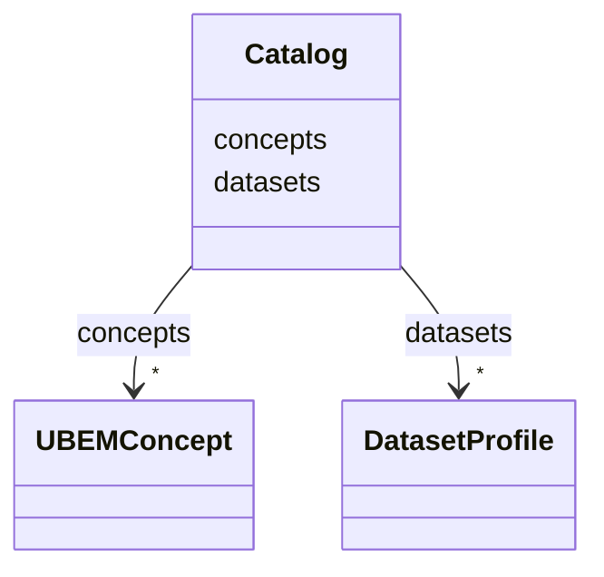

---
search:
  boost: 10.0
---

# Class: Catalog 


_A collection of dataset profiles and the concept vocabulary they refer to._


<div data-search-exclude markdown="1">


URI: [dcat:Catalog](http://www.w3.org/ns/dcat#Catalog)





<!-- no inheritance hierarchy -->

## Class Properties

| Property | Value |
| --- | --- |
| Class URI | [dcat:Catalog](http://www.w3.org/ns/dcat#Catalog) |
| Tree Root | Yes |


## Slots

| Name | Cardinality and Range | Description | Inheritance |
| ---  | --- | --- | --- |
| [datasets](datasets.md) | * <br/> [DatasetProfile](DatasetProfile.md) | Dataset profiles held in the catalog | direct |
| [concepts](concepts.md) | * <br/> [UBEMConcept](UBEMConcept.md) | Concepts of the vocabulary held in the catalog | direct |


## Identifier and Mapping Information


### Schema Source


* from schema: https://w3id.org/ubem-link/schema


## Mappings

| Mapping Type | Mapped Value |
| ---  | ---  |
| self | dcat:Catalog |
| native | ubem_link:Catalog |


## LinkML Source

<!-- TODO: investigate https://stackoverflow.com/questions/37606292/how-to-create-tabbed-code-blocks-in-mkdocs-or-sphinx -->

### Direct

<details>
```yaml
name: Catalog
description: A collection of dataset profiles and the concept vocabulary they refer
  to.
from_schema: https://w3id.org/ubem-link/schema
slots:
- datasets
- concepts
class_uri: dcat:Catalog
tree_root: true

```
</details>

### Induced

<details>
```yaml
name: Catalog
description: A collection of dataset profiles and the concept vocabulary they refer
  to.
from_schema: https://w3id.org/ubem-link/schema
attributes:
  datasets:
    name: datasets
    description: Dataset profiles held in the catalog.
    from_schema: https://w3id.org/ubem-link/schema
    rank: 1000
    owner: Catalog
    domain_of:
    - Catalog
    range: DatasetProfile
    multivalued: true
    inlined: true
    inlined_as_list: true
  concepts:
    name: concepts
    description: Concepts of the vocabulary held in the catalog.
    from_schema: https://w3id.org/ubem-link/schema
    rank: 1000
    owner: Catalog
    domain_of:
    - Catalog
    range: UBEMConcept
    multivalued: true
    inlined: true
    inlined_as_list: true
class_uri: dcat:Catalog
tree_root: true

```
</details></div>