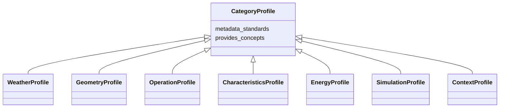

---
search:
  boost: 10.0
---

# Class: CategoryProfile 


_Category-specific part of a dataset profile: what a modeler must know about one kind of UBEM data before using it. There is one profile class per UBEM workflow role. Existing classifications of open UBEM data record this information as free-text checklists; here every field is typed with a closed value list, macroscopic and microscopic energy data share EnergyProfile and differ in energy_data_scale, and a data lake is a Catalog of profiles rather than a category._


<div data-search-exclude markdown="1">


* __NOTE__: this is an abstract class and should not be instantiated directly


URI: [ubem_link:CategoryProfile](https://w3id.org/ubem-link/CategoryProfile)





## Inheritance
* **CategoryProfile**
    * [WeatherProfile](WeatherProfile.md)
    * [GeometryProfile](GeometryProfile.md)
    * [OperationProfile](OperationProfile.md)
    * [CharacteristicsProfile](CharacteristicsProfile.md)
    * [EnergyProfile](EnergyProfile.md)
    * [SimulationProfile](SimulationProfile.md)
    * [ContextProfile](ContextProfile.md)


## Slots

| Name | Cardinality and Range | Description | Inheritance |
| ---  | --- | --- | --- |
| [provides_concepts](provides_concepts.md) | * <br/> [String](String.md) | Ids of the UBEM-Link concepts the dataset provides values for (its content at... | direct |
| [metadata_standards](metadata_standards.md) | * <br/> [String](String.md) | Metadata standards or schemas the publisher already uses (for example Brick, ... | direct |


## Identifier and Mapping Information


### Schema Source


* from schema: https://w3id.org/ubem-link/schema


## Mappings

| Mapping Type | Mapped Value |
| ---  | ---  |
| self | ubem_link:CategoryProfile |
| native | ubem_link:CategoryProfile |


## LinkML Source

<!-- TODO: investigate https://stackoverflow.com/questions/37606292/how-to-create-tabbed-code-blocks-in-mkdocs-or-sphinx -->

### Direct

<details>
```yaml
name: CategoryProfile
description: 'Category-specific part of a dataset profile: what a modeler must know
  about one kind of UBEM data before using it. There is one profile class per UBEM
  workflow role. Existing classifications of open UBEM data record this information
  as free-text checklists; here every field is typed with a closed value list, macroscopic
  and microscopic energy data share EnergyProfile and differ in energy_data_scale,
  and a data lake is a Catalog of profiles rather than a category.'
from_schema: https://w3id.org/ubem-link/schema
abstract: true
slots:
- provides_concepts
- metadata_standards

```
</details>

### Induced

<details>
```yaml
name: CategoryProfile
description: 'Category-specific part of a dataset profile: what a modeler must know
  about one kind of UBEM data before using it. There is one profile class per UBEM
  workflow role. Existing classifications of open UBEM data record this information
  as free-text checklists; here every field is typed with a closed value list, macroscopic
  and microscopic energy data share EnergyProfile and differ in energy_data_scale,
  and a data lake is a Catalog of profiles rather than a category.'
from_schema: https://w3id.org/ubem-link/schema
abstract: true
attributes:
  provides_concepts:
    name: provides_concepts
    description: Ids of the UBEM-Link concepts the dataset provides values for (its
      content at concept level).
    from_schema: https://w3id.org/ubem-link/schema
    rank: 1000
    owner: CategoryProfile
    domain_of:
    - CategoryProfile
    range: string
    multivalued: true
  metadata_standards:
    name: metadata_standards
    description: Metadata standards or schemas the publisher already uses (for example
      Brick, BuildingSync, DDI-Codebook, CityGML).
    from_schema: https://w3id.org/ubem-link/schema
    rank: 1000
    owner: CategoryProfile
    domain_of:
    - CategoryProfile
    range: string
    multivalued: true

```
</details></div>