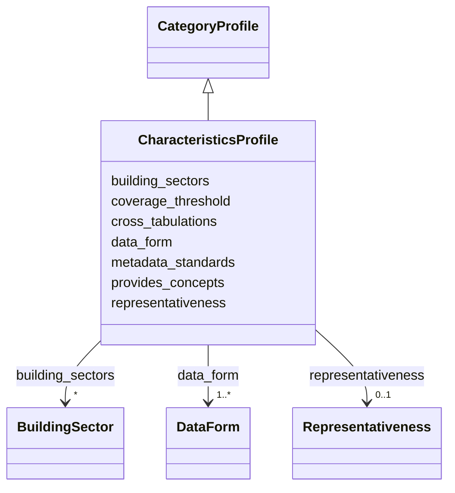

---
search:
  boost: 10.0
---

# Class: CharacteristicsProfile 


_Non-geometric building characteristics (use type, vintage, envelope, systems, fuels) from surveys, administrative records, certificates and dictionaries._


<div data-search-exclude markdown="1">


URI: [ubem_link:CharacteristicsProfile](https://w3id.org/ubem-link/CharacteristicsProfile)





## Inheritance
* [CategoryProfile](CategoryProfile.md)
    * **CharacteristicsProfile**


## Slots

| Name | Cardinality and Range | Description | Inheritance |
| ---  | --- | --- | --- |
| [data_form](data_form.md) | 1..* <br/> [DataForm](DataForm.md) | Whether the data are records of individual units (microdata or building recor... | direct |
| [building_sectors](building_sectors.md) | * <br/> [BuildingSector](BuildingSector.md) | Building sectors covered | direct |
| [representativeness](representativeness.md) | 0..1 <br/> [Representativeness](Representativeness.md) | How the covered buildings relate to the building stock, which decides whether... | direct |
| [coverage_threshold](coverage_threshold.md) | 0..1 <br/> [String](String.md) | Size or other threshold that decides which buildings are covered (for example... | direct |
| [cross_tabulations](cross_tabulations.md) | * <br/> [String](String.md) | For aggregate tables, the joint distributions published, each as concept ids ... | direct |
| [provides_concepts](provides_concepts.md) | * <br/> [String](String.md) | Ids of the UBEM-Link concepts the dataset provides values for (its content at... | [CategoryProfile](CategoryProfile.md) |
| [metadata_standards](metadata_standards.md) | * <br/> [String](String.md) | Metadata standards or schemas the publisher already uses (for example Brick, ... | [CategoryProfile](CategoryProfile.md) |


## Usages

| used by | used in | type | used |
| ---  | --- | --- | --- |
| [DatasetProfile](DatasetProfile.md) | [characteristics_profile](characteristics_profile.md) | range | [CharacteristicsProfile](CharacteristicsProfile.md) |


## Identifier and Mapping Information


### Schema Source


* from schema: https://w3id.org/ubem-link/schema


## Mappings

| Mapping Type | Mapped Value |
| ---  | ---  |
| self | ubem_link:CharacteristicsProfile |
| native | ubem_link:CharacteristicsProfile |


## LinkML Source

<!-- TODO: investigate https://stackoverflow.com/questions/37606292/how-to-create-tabbed-code-blocks-in-mkdocs-or-sphinx -->

### Direct

<details>
```yaml
name: CharacteristicsProfile
description: Non-geometric building characteristics (use type, vintage, envelope,
  systems, fuels) from surveys, administrative records, certificates and dictionaries.
from_schema: https://w3id.org/ubem-link/schema
is_a: CategoryProfile
slots:
- data_form
- building_sectors
- representativeness
- coverage_threshold
- cross_tabulations
slot_usage:
  data_form:
    name: data_form
    required: true

```
</details>

### Induced

<details>
```yaml
name: CharacteristicsProfile
description: Non-geometric building characteristics (use type, vintage, envelope,
  systems, fuels) from surveys, administrative records, certificates and dictionaries.
from_schema: https://w3id.org/ubem-link/schema
is_a: CategoryProfile
slot_usage:
  data_form:
    name: data_form
    required: true
attributes:
  data_form:
    name: data_form
    description: Whether the data are records of individual units (microdata or building
      records) or published distributions (aggregate tables).
    from_schema: https://w3id.org/ubem-link/schema
    rank: 1000
    owner: CharacteristicsProfile
    domain_of:
    - CharacteristicsProfile
    range: DataForm
    required: true
    multivalued: true
  building_sectors:
    name: building_sectors
    description: Building sectors covered.
    from_schema: https://w3id.org/ubem-link/schema
    rank: 1000
    owner: CharacteristicsProfile
    domain_of:
    - OperationProfile
    - CharacteristicsProfile
    - SimulationProfile
    range: BuildingSector
    multivalued: true
  representativeness:
    name: representativeness
    description: How the covered buildings relate to the building stock, which decides
      whether results generalize.
    from_schema: https://w3id.org/ubem-link/schema
    rank: 1000
    owner: CharacteristicsProfile
    domain_of:
    - CharacteristicsProfile
    range: Representativeness
  coverage_threshold:
    name: coverage_threshold
    description: Size or other threshold that decides which buildings are covered
      (for example 'more than 25,000 ft²').
    from_schema: https://w3id.org/ubem-link/schema
    rank: 1000
    owner: CharacteristicsProfile
    domain_of:
    - CharacteristicsProfile
    range: string
  cross_tabulations:
    name: cross_tabulations
    description: For aggregate tables, the joint distributions published, each as
      concept ids joined by ' x '.
    from_schema: https://w3id.org/ubem-link/schema
    rank: 1000
    owner: CharacteristicsProfile
    domain_of:
    - CharacteristicsProfile
    range: string
    multivalued: true
  provides_concepts:
    name: provides_concepts
    description: Ids of the UBEM-Link concepts the dataset provides values for (its
      content at concept level).
    from_schema: https://w3id.org/ubem-link/schema
    rank: 1000
    owner: CharacteristicsProfile
    domain_of:
    - CategoryProfile
    range: string
    multivalued: true
  metadata_standards:
    name: metadata_standards
    description: Metadata standards or schemas the publisher already uses (for example
      Brick, BuildingSync, DDI-Codebook, CityGML).
    from_schema: https://w3id.org/ubem-link/schema
    rank: 1000
    owner: CharacteristicsProfile
    domain_of:
    - CategoryProfile
    range: string
    multivalued: true

```
</details></div>