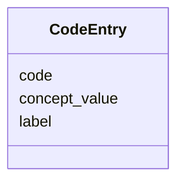

---
search:
  boost: 10.0
---

# Class: CodeEntry 


_One code of a categorical variable and its meaning._


<div data-search-exclude markdown="1">


URI: [skos:Concept](http://www.w3.org/2004/02/skos/core#Concept)





<!-- no inheritance hierarchy -->

## Class Properties

| Property | Value |
| --- | --- |
| Class URI | [skos:Concept](http://www.w3.org/2004/02/skos/core#Concept) |


## Slots

| Name | Cardinality and Range | Description | Inheritance |
| ---  | --- | --- | --- |
| [code](code.md) | 0..1 <br/> [String](String.md) | A value as stored in the data | direct |
| [label](label.md) | 0..1 <br/> [String](String.md) | Short human-readable label of the variable as given in the codebook | direct |
| [concept_value](concept_value.md) | 0..1 <br/> [String](String.md) | Optional normalized value in the target concept (e | direct |


## Usages

| used by | used in | type | used |
| ---  | --- | --- | --- |
| [VariableProfile](VariableProfile.md) | [code_list](code_list.md) | range | [CodeEntry](CodeEntry.md) |


## Identifier and Mapping Information


### Schema Source


* from schema: https://w3id.org/ubem-link/schema


## Mappings

| Mapping Type | Mapped Value |
| ---  | ---  |
| self | skos:Concept |
| native | ubem_link:CodeEntry |


## LinkML Source

<!-- TODO: investigate https://stackoverflow.com/questions/37606292/how-to-create-tabbed-code-blocks-in-mkdocs-or-sphinx -->

### Direct

<details>
```yaml
name: CodeEntry
description: One code of a categorical variable and its meaning.
from_schema: https://w3id.org/ubem-link/schema
slots:
- code
- label
- concept_value
class_uri: skos:Concept

```
</details>

### Induced

<details>
```yaml
name: CodeEntry
description: One code of a categorical variable and its meaning.
from_schema: https://w3id.org/ubem-link/schema
attributes:
  code:
    name: code
    description: A value as stored in the data.
    from_schema: https://w3id.org/ubem-link/schema
    rank: 1000
    owner: CodeEntry
    domain_of:
    - CodeEntry
    range: string
  label:
    name: label
    description: Short human-readable label of the variable as given in the codebook.
    from_schema: https://w3id.org/ubem-link/schema
    rank: 1000
    slot_uri: skos:prefLabel
    owner: CodeEntry
    domain_of:
    - VariableProfile
    - CodeEntry
    range: string
  concept_value:
    name: concept_value
    description: Optional normalized value in the target concept (e.g., an ASHRAE
      climate zone id).
    from_schema: https://w3id.org/ubem-link/schema
    rank: 1000
    owner: CodeEntry
    domain_of:
    - CodeEntry
    range: string
class_uri: skos:Concept

```
</details></div>