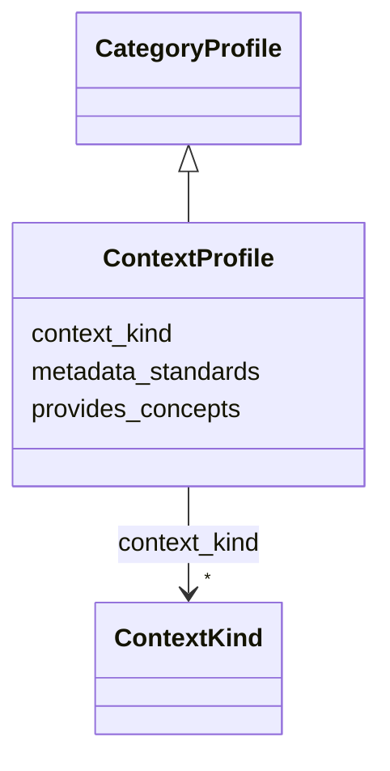

---
search:
  boost: 10.0
---

# Class: ContextProfile 


_Context and coupling data: socio-economic data, land use, grid emissions, tariffs and urban climate._


<div data-search-exclude markdown="1">


URI: [ubem_link:ContextProfile](https://w3id.org/ubem-link/ContextProfile)





## Inheritance
* [CategoryProfile](CategoryProfile.md)
    * **ContextProfile**


## Slots

| Name | Cardinality and Range | Description | Inheritance |
| ---  | --- | --- | --- |
| [context_kind](context_kind.md) | * <br/> [ContextKind](ContextKind.md) | Kind of context or coupling data | direct |
| [provides_concepts](provides_concepts.md) | * <br/> [String](String.md) | Ids of the UBEM-Link concepts the dataset provides values for (its content at... | [CategoryProfile](CategoryProfile.md) |
| [metadata_standards](metadata_standards.md) | * <br/> [String](String.md) | Metadata standards or schemas the publisher already uses (for example Brick, ... | [CategoryProfile](CategoryProfile.md) |


## Usages

| used by | used in | type | used |
| ---  | --- | --- | --- |
| [DatasetProfile](DatasetProfile.md) | [context_profile](context_profile.md) | range | [ContextProfile](ContextProfile.md) |


## Identifier and Mapping Information


### Schema Source


* from schema: https://w3id.org/ubem-link/schema


## Mappings

| Mapping Type | Mapped Value |
| ---  | ---  |
| self | ubem_link:ContextProfile |
| native | ubem_link:ContextProfile |


## LinkML Source

<!-- TODO: investigate https://stackoverflow.com/questions/37606292/how-to-create-tabbed-code-blocks-in-mkdocs-or-sphinx -->

### Direct

<details>
```yaml
name: ContextProfile
description: 'Context and coupling data: socio-economic data, land use, grid emissions,
  tariffs and urban climate.'
from_schema: https://w3id.org/ubem-link/schema
is_a: CategoryProfile
slots:
- context_kind

```
</details>

### Induced

<details>
```yaml
name: ContextProfile
description: 'Context and coupling data: socio-economic data, land use, grid emissions,
  tariffs and urban climate.'
from_schema: https://w3id.org/ubem-link/schema
is_a: CategoryProfile
attributes:
  context_kind:
    name: context_kind
    description: Kind of context or coupling data.
    from_schema: https://w3id.org/ubem-link/schema
    rank: 1000
    owner: ContextProfile
    domain_of:
    - ContextProfile
    range: ContextKind
    multivalued: true
  provides_concepts:
    name: provides_concepts
    description: Ids of the UBEM-Link concepts the dataset provides values for (its
      content at concept level).
    from_schema: https://w3id.org/ubem-link/schema
    rank: 1000
    owner: ContextProfile
    domain_of:
    - CategoryProfile
    range: string
    multivalued: true
  metadata_standards:
    name: metadata_standards
    description: Metadata standards or schemas the publisher already uses (for example
      Brick, BuildingSync, DDI-Codebook, CityGML).
    from_schema: https://w3id.org/ubem-link/schema
    rank: 1000
    owner: ContextProfile
    domain_of:
    - CategoryProfile
    range: string
    multivalued: true

```
</details></div>