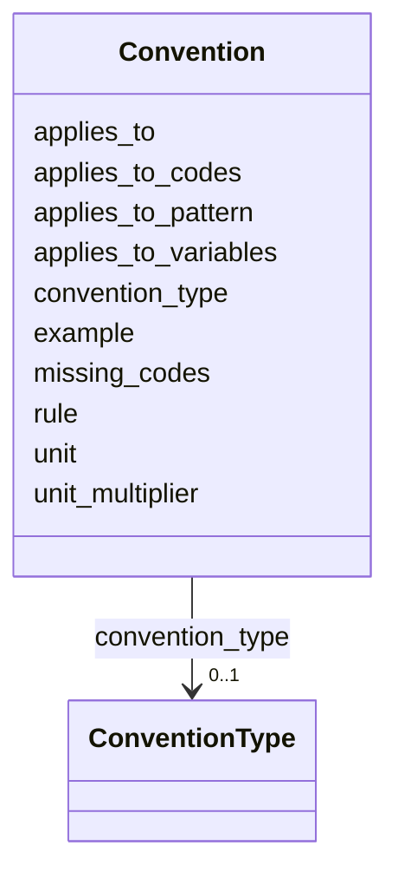

---
search:
  boost: 10.0
---

# Class: Convention 


_A rule the publisher applies to many variables at once, such as a naming pattern for imputation flags, a code that means "not applicable", or a unit used for all energy totals. Conventions are usually stated once in a user guide and never in the individual codebook entries, so a person or an AI system reading one entry cannot infer them; the profile states them explicitly._


<div data-search-exclude markdown="1">


URI: [ubem_link:Convention](https://w3id.org/ubem-link/Convention)





<!-- no inheritance hierarchy -->

## Slots

| Name | Cardinality and Range | Description | Inheritance |
| ---  | --- | --- | --- |
| [convention_type](convention_type.md) | 0..1 <br/> [ConventionType](ConventionType.md) | What the convention concerns, so that tools can apply it (missing codes, unit... | direct |
| [applies_to](applies_to.md) | 0..1 <br/> [String](String.md) | Which variables the convention applies to (a name pattern or a description) | direct |
| [applies_to_variables](applies_to_variables.md) | * <br/> [String](String.md) | Exact names of the variables a convention applies to (machine-readable scope) | direct |
| [applies_to_pattern](applies_to_pattern.md) | 0..1 <br/> [String](String.md) | Regular expression over variable names giving the variables a convention appl... | direct |
| [applies_to_codes](applies_to_codes.md) | * <br/> [String](String.md) | Codes or code labels that must all occur in a variable's documented codes for... | direct |
| [rule](rule.md) | 1 <br/> [String](String.md) | The convention, stated as a rule that can be applied without other context | direct |
| [example](example.md) | 0..1 <br/> [String](String.md) | One concrete example of the rule from the dataset | direct |
| [missing_codes](missing_codes.md) | * <br/> [String](String.md) | Raw values that mean missing, not applicable, or suppressed | direct |
| [unit](unit.md) | 0..1 <br/> [String](String.md) | QUDT unit CURIE, e | direct |
| [unit_multiplier](unit_multiplier.md) | 0..1 <br/> [Float](Float.md) | Factor applied to raw values before the unit applies (e | direct |


## Usages

| used by | used in | type | used |
| ---  | --- | --- | --- |
| [DatasetProfile](DatasetProfile.md) | [conventions](conventions.md) | range | [Convention](Convention.md) |


## Identifier and Mapping Information


### Schema Source


* from schema: https://w3id.org/ubem-link/schema


## Mappings

| Mapping Type | Mapped Value |
| ---  | ---  |
| self | ubem_link:Convention |
| native | ubem_link:Convention |


## LinkML Source

<!-- TODO: investigate https://stackoverflow.com/questions/37606292/how-to-create-tabbed-code-blocks-in-mkdocs-or-sphinx -->

### Direct

<details>
```yaml
name: Convention
description: A rule the publisher applies to many variables at once, such as a naming
  pattern for imputation flags, a code that means "not applicable", or a unit used
  for all energy totals. Conventions are usually stated once in a user guide and never
  in the individual codebook entries, so a person or an AI system reading one entry
  cannot infer them; the profile states them explicitly.
from_schema: https://w3id.org/ubem-link/schema
slots:
- convention_type
- applies_to
- applies_to_variables
- applies_to_pattern
- applies_to_codes
- rule
- example
- missing_codes
- unit
- unit_multiplier
slot_usage:
  rule:
    name: rule
    required: true

```
</details>

### Induced

<details>
```yaml
name: Convention
description: A rule the publisher applies to many variables at once, such as a naming
  pattern for imputation flags, a code that means "not applicable", or a unit used
  for all energy totals. Conventions are usually stated once in a user guide and never
  in the individual codebook entries, so a person or an AI system reading one entry
  cannot infer them; the profile states them explicitly.
from_schema: https://w3id.org/ubem-link/schema
slot_usage:
  rule:
    name: rule
    required: true
attributes:
  convention_type:
    name: convention_type
    description: What the convention concerns, so that tools can apply it (missing
      codes, units, flags, keys).
    from_schema: https://w3id.org/ubem-link/schema
    rank: 1000
    owner: Convention
    domain_of:
    - Convention
    range: ConventionType
  applies_to:
    name: applies_to
    description: Which variables the convention applies to (a name pattern or a description).
    from_schema: https://w3id.org/ubem-link/schema
    rank: 1000
    owner: Convention
    domain_of:
    - Convention
    range: string
  applies_to_variables:
    name: applies_to_variables
    description: Exact names of the variables a convention applies to (machine-readable
      scope).
    from_schema: https://w3id.org/ubem-link/schema
    rank: 1000
    owner: Convention
    domain_of:
    - Convention
    range: string
    multivalued: true
  applies_to_pattern:
    name: applies_to_pattern
    description: Regular expression over variable names giving the variables a convention
      applies to (machine-readable scope).
    from_schema: https://w3id.org/ubem-link/schema
    rank: 1000
    owner: Convention
    domain_of:
    - Convention
    range: string
  applies_to_codes:
    name: applies_to_codes
    description: Codes or code labels that must all occur in a variable's documented
      codes for the convention to apply (machine-readable scope by code list, for
      example Yes, No and Don't know for yes/no questions).
    from_schema: https://w3id.org/ubem-link/schema
    rank: 1000
    owner: Convention
    domain_of:
    - Convention
    range: string
    multivalued: true
  rule:
    name: rule
    description: The convention, stated as a rule that can be applied without other
      context.
    from_schema: https://w3id.org/ubem-link/schema
    rank: 1000
    owner: Convention
    domain_of:
    - Convention
    range: string
    required: true
  example:
    name: example
    description: One concrete example of the rule from the dataset.
    from_schema: https://w3id.org/ubem-link/schema
    rank: 1000
    owner: Convention
    domain_of:
    - Convention
    range: string
  missing_codes:
    name: missing_codes
    description: Raw values that mean missing, not applicable, or suppressed.
    from_schema: https://w3id.org/ubem-link/schema
    rank: 1000
    owner: Convention
    domain_of:
    - Convention
    - VariableProfile
    range: string
    multivalued: true
  unit:
    name: unit
    description: QUDT unit CURIE, e.g. unit:FT2, unit:KiloBTU_IT, unit:KiloW-HR, unit:DEG_C.
    from_schema: https://w3id.org/ubem-link/schema
    rank: 1000
    slot_uri: qudt:unit
    owner: Convention
    domain_of:
    - Convention
    - VariableProfile
    range: string
  unit_multiplier:
    name: unit_multiplier
    description: Factor applied to raw values before the unit applies (e.g., 1000
      for "thousand Btu").
    from_schema: https://w3id.org/ubem-link/schema
    rank: 1000
    owner: Convention
    domain_of:
    - Convention
    - VariableProfile
    range: float

```
</details></div>