---
search:
  boost: 10.0
---

# Class: DatasetProfile 


_Dataset-level description of one open dataset, sufficient to decide whether and how it can feed a UBEM workflow, and to join it with other datasets._


<div data-search-exclude markdown="1">


URI: [dcat:Dataset](http://www.w3.org/ns/dcat#Dataset)

```mermaid
 classDiagram
    class DatasetProfile
    click DatasetProfile href "../DatasetProfile/"
      DatasetProfile : access_level
        
          
    
        
        
        DatasetProfile --> "1" AccessLevel : access_level
        click AccessLevel href "../AccessLevel/"
    

        
      DatasetProfile : characteristics_profile
        
          
    
        
        
        DatasetProfile --> "0..1" CharacteristicsProfile : characteristics_profile
        click CharacteristicsProfile href "../CharacteristicsProfile/"
    

        
      DatasetProfile : citation
        
      DatasetProfile : content_types
        
      DatasetProfile : context_profile
        
          
    
        
        
        DatasetProfile --> "0..1" ContextProfile : context_profile
        click ContextProfile href "../ContextProfile/"
    

        
      DatasetProfile : conventions
        
          
    
        
        
        DatasetProfile --> "*" Convention : conventions
        click Convention href "../Convention/"
    

        
      DatasetProfile : distributions
        
          
    
        
        
        DatasetProfile --> "*" Distribution : distributions
        click Distribution href "../Distribution/"
    

        
      DatasetProfile : doi
        
      DatasetProfile : energy_profile
        
          
    
        
        
        DatasetProfile --> "0..1" EnergyProfile : energy_profile
        click EnergyProfile href "../EnergyProfile/"
    

        
      DatasetProfile : geographic_scope
        
          
    
        
        
        DatasetProfile --> "0..1" GeographicScope : geographic_scope
        click GeographicScope href "../GeographicScope/"
    

        
      DatasetProfile : geometry_profile
        
          
    
        
        
        DatasetProfile --> "0..1" GeometryProfile : geometry_profile
        click GeometryProfile href "../GeometryProfile/"
    

        
      DatasetProfile : id
        
      DatasetProfile : join_keys
        
          
    
        
        
        DatasetProfile --> "*" JoinKey : join_keys
        click JoinKey href "../JoinKey/"
    

        
      DatasetProfile : known_limitations
        
      DatasetProfile : landing_page
        
      DatasetProfile : license
        
      DatasetProfile : machine_readable
        
      DatasetProfile : notes
        
      DatasetProfile : operation_profile
        
          
    
        
        
        DatasetProfile --> "0..1" OperationProfile : operation_profile
        click OperationProfile href "../OperationProfile/"
    

        
      DatasetProfile : persistent_identifier
        
      DatasetProfile : publisher
        
      DatasetProfile : record_count
        
      DatasetProfile : record_count_note
        
      DatasetProfile : reference_paper_doi
        
      DatasetProfile : sampling_weights
        
      DatasetProfile : short_name
        
      DatasetProfile : simulation_profile
        
          
    
        
        
        DatasetProfile --> "0..1" SimulationProfile : simulation_profile
        click SimulationProfile href "../SimulationProfile/"
    

        
      DatasetProfile : spatial_coverage
        
          
    
        
        
        DatasetProfile --> "0..1" SpatialCoverage : spatial_coverage
        click SpatialCoverage href "../SpatialCoverage/"
    

        
      DatasetProfile : spatial_granularity
        
          
    
        
        
        DatasetProfile --> "1" SpatialGranularity : spatial_granularity
        click SpatialGranularity href "../SpatialGranularity/"
    

        
      DatasetProfile : statistical_nature
        
          
    
        
        
        DatasetProfile --> "1" StatisticalNature : statistical_nature
        click StatisticalNature href "../StatisticalNature/"
    

        
      DatasetProfile : temporal_coverage
        
          
    
        
        
        DatasetProfile --> "0..1" TemporalCoverage : temporal_coverage
        click TemporalCoverage href "../TemporalCoverage/"
    

        
      DatasetProfile : temporal_resolution
        
      DatasetProfile : title
        
      DatasetProfile : ubem_roles
        
          
    
        
        
        DatasetProfile --> "1..*" UBEMRole : ubem_roles
        click UBEMRole href "../UBEMRole/"
    

        
      DatasetProfile : unit_of_observation
        
      DatasetProfile : update_frequency
        
      DatasetProfile : variables
        
          
    
        
        
        DatasetProfile --> "*" VariableProfile : variables
        click VariableProfile href "../VariableProfile/"
    

        
      DatasetProfile : variables_documented
        
      DatasetProfile : verified
        
          
    
        
        
        DatasetProfile --> "0..1" Verification : verified
        click Verification href "../Verification/"
    

        
      DatasetProfile : versioned
        
      DatasetProfile : weather_profile
        
          
    
        
        
        DatasetProfile --> "0..1" WeatherProfile : weather_profile
        click WeatherProfile href "../WeatherProfile/"
    

        
      
```





<!-- no inheritance hierarchy -->

## Class Properties

| Property | Value |
| --- | --- |
| Class URI | [dcat:Dataset](http://www.w3.org/ns/dcat#Dataset) |


## Slots

| Name | Cardinality and Range | Description | Inheritance |
| ---  | --- | --- | --- |
| [id](id.md) | 1 <br/> [String](String.md) | Stable lowercase identifier of the record (letters, digits, '_', ' | direct |
| [title](title.md) | 1 <br/> [String](String.md) | Full title of the dataset as given by its publisher | direct |
| [short_name](short_name.md) | 0..1 <br/> [String](String.md) | Common short name or acronym of the dataset (for example CBECS 2018) | direct |
| [publisher](publisher.md) | 0..1 <br/> [String](String.md) | Organization that publishes and maintains the dataset | direct |
| [landing_page](landing_page.md) | 0..1 <br/> [Uri](Uri.md) | Web page of the dataset maintained by the publisher | direct |
| [doi](doi.md) | 0..1 <br/> [String](String.md) | DOI of the dataset itself (bare form, e | direct |
| [citation](citation.md) | 0..1 <br/> [String](String.md) | Citation text the publisher asks users to give | direct |
| [reference_paper_doi](reference_paper_doi.md) | 0..1 <br/> [String](String.md) | DOI of a peer-reviewed paper that describes the dataset | direct |
| [license](license.md) | 0..1 <br/> [String](String.md) | License or terms of use, as stated by the publisher (SPDX identifier where on... | direct |
| [access_level](access_level.md) | 1 <br/> [AccessLevel](AccessLevel.md) | How the data can be obtained, from open download to restricted or commercial ... | direct |
| [distributions](distributions.md) | * <br/> [Distribution](Distribution.md) | The downloadable files or services through which the data are released | direct |
| [ubem_roles](ubem_roles.md) | 1..* <br/> [UBEMRole](UBEMRole.md) | UBEM workflow steps the dataset feeds; first value is the primary role | direct |
| [content_types](content_types.md) | * <br/> [String](String.md) | Kinds of content in the dataset (for example footprints, microdata, hourly lo... | direct |
| [geographic_scope](geographic_scope.md) | 0..1 <br/> [GeographicScope](GeographicScope.md) | Extent of the area covered, from city to global | direct |
| [spatial_coverage](spatial_coverage.md) | 0..1 <br/> [SpatialCoverage](SpatialCoverage.md) | Area the dataset covers, as countries and optional regions | direct |
| [unit_of_observation](unit_of_observation.md) | 0..1 <br/> [String](String.md) | What one record describes (building, meter, household, station, grid_cell, re... | direct |
| [spatial_granularity](spatial_granularity.md) | 1 <br/> [SpatialGranularity](SpatialGranularity.md) | Finest location detail released publicly | direct |
| [temporal_coverage](temporal_coverage.md) | 0..1 <br/> [TemporalCoverage](TemporalCoverage.md) | Period the data describe | direct |
| [temporal_resolution](temporal_resolution.md) | 0..1 <br/> [String](String.md) | ISO 8601 duration of the finest time step, or "static" or "irregular" | direct |
| [update_frequency](update_frequency.md) | 0..1 <br/> [String](String.md) | How often the publisher releases new data (for example annual, irregular) | direct |
| [statistical_nature](statistical_nature.md) | 1 <br/> [StatisticalNature](StatisticalNature.md) | How the data were generated, which decides how they may be analyzed (for exam... | direct |
| [sampling_weights](sampling_weights.md) | 0..1 <br/> [String](String.md) | Weight variables and how to use them (required for weighted sample surveys) | direct |
| [conventions](conventions.md) | * <br/> [Convention](Convention.md) | Dataset-wide rules for naming, coding and units that apply to many variables | direct |
| [record_count](record_count.md) | 0..1 <br/> [Integer](Integer.md) | Number of records (rows, buildings, meters or stations) in the dataset | direct |
| [record_count_note](record_count_note.md) | 0..1 <br/> [String](String.md) | What the record count counts and its source | direct |
| [join_keys](join_keys.md) | * <br/> [JoinKey](JoinKey.md) | Keys present in the public data that allow records to be linked to other data... | direct |
| [variables_documented](variables_documented.md) | 0..1 <br/> [Boolean](Boolean.md) | True if the publisher documents every variable (codebook or data dictionary) | direct |
| [machine_readable](machine_readable.md) | 0..1 <br/> [Boolean](Boolean.md) | True if the data are released in a machine-readable format, not only as repor... | direct |
| [versioned](versioned.md) | 0..1 <br/> [Boolean](Boolean.md) | True if the publisher identifies releases with versions | direct |
| [persistent_identifier](persistent_identifier.md) | 0..1 <br/> [Boolean](Boolean.md) | True if the dataset has a persistent identifier such as a DOI | direct |
| [known_limitations](known_limitations.md) | 0..1 <br/> [String](String.md) | Limitations a user must know before using the data (bias, coverage gaps, supp... | direct |
| [notes](notes.md) | 0..1 <br/> [String](String.md) | Other information about the dataset or about how its profile was verified | direct |
| [verified](verified.md) | 0..1 <br/> [Verification](Verification.md) | Provenance of the profile: who checked it, when and against which sources | direct |
| [weather_profile](weather_profile.md) | 0..1 <br/> [WeatherProfile](WeatherProfile.md) | Category profile for a dataset with the role boundary_conditions | direct |
| [geometry_profile](geometry_profile.md) | 0..1 <br/> [GeometryProfile](GeometryProfile.md) | Category profile for a dataset with the role geometry_inventory | direct |
| [operation_profile](operation_profile.md) | 0..1 <br/> [OperationProfile](OperationProfile.md) | Category profile for a dataset with the role operation_use | direct |
| [characteristics_profile](characteristics_profile.md) | 0..1 <br/> [CharacteristicsProfile](CharacteristicsProfile.md) | Category profile for a dataset with the role building_characteristics | direct |
| [energy_profile](energy_profile.md) | 0..1 <br/> [EnergyProfile](EnergyProfile.md) | Category profile for a dataset with the role calibration_validation | direct |
| [simulation_profile](simulation_profile.md) | 0..1 <br/> [SimulationProfile](SimulationProfile.md) | Category profile for a dataset with the role reference_simulation | direct |
| [context_profile](context_profile.md) | 0..1 <br/> [ContextProfile](ContextProfile.md) | Category profile for a dataset with the role context_coupling | direct |
| [variables](variables.md) | * <br/> [VariableProfile](VariableProfile.md) | Variable-level profiles of the dataset's columns | direct |


## Usages

| used by | used in | type | used |
| ---  | --- | --- | --- |
| [Catalog](Catalog.md) | [datasets](datasets.md) | range | [DatasetProfile](DatasetProfile.md) |


## Rules


### 

| Rule Applied | Preconditions | Postconditions | Elseconditions |
|--------------|---------------|----------------|----------------|
| slot_conditions |```{'statistical_nature': {'equals_string': 'sample_survey_weighted'}}``` |```{'sampling_weights': {'required': True}}``` | |


## Identifier and Mapping Information


### Schema Source


* from schema: https://w3id.org/ubem-link/schema


## Mappings

| Mapping Type | Mapped Value |
| ---  | ---  |
| self | dcat:Dataset |
| native | ubem_link:DatasetProfile |


## LinkML Source

<!-- TODO: investigate https://stackoverflow.com/questions/37606292/how-to-create-tabbed-code-blocks-in-mkdocs-or-sphinx -->

### Direct

<details>
```yaml
name: DatasetProfile
description: Dataset-level description of one open dataset, sufficient to decide whether
  and how it can feed a UBEM workflow, and to join it with other datasets.
from_schema: https://w3id.org/ubem-link/schema
slots:
- id
- title
- short_name
- publisher
- landing_page
- doi
- citation
- reference_paper_doi
- license
- access_level
- distributions
- ubem_roles
- content_types
- geographic_scope
- spatial_coverage
- unit_of_observation
- spatial_granularity
- temporal_coverage
- temporal_resolution
- update_frequency
- statistical_nature
- sampling_weights
- conventions
- record_count
- record_count_note
- join_keys
- variables_documented
- machine_readable
- versioned
- persistent_identifier
- known_limitations
- notes
- verified
- weather_profile
- geometry_profile
- operation_profile
- characteristics_profile
- energy_profile
- simulation_profile
- context_profile
- variables
slot_usage:
  id:
    name: id
    required: true
  title:
    name: title
    required: true
  ubem_roles:
    name: ubem_roles
    required: true
  statistical_nature:
    name: statistical_nature
    required: true
  spatial_granularity:
    name: spatial_granularity
    required: true
  access_level:
    name: access_level
    required: true
class_uri: dcat:Dataset
rules:
- preconditions:
    slot_conditions:
      statistical_nature:
        name: statistical_nature
        equals_string: sample_survey_weighted
  postconditions:
    slot_conditions:
      sampling_weights:
        name: sampling_weights
        required: true
  description: A weighted sample survey must name its weights.

```
</details>

### Induced

<details>
```yaml
name: DatasetProfile
description: Dataset-level description of one open dataset, sufficient to decide whether
  and how it can feed a UBEM workflow, and to join it with other datasets.
from_schema: https://w3id.org/ubem-link/schema
slot_usage:
  id:
    name: id
    required: true
  title:
    name: title
    required: true
  ubem_roles:
    name: ubem_roles
    required: true
  statistical_nature:
    name: statistical_nature
    required: true
  spatial_granularity:
    name: spatial_granularity
    required: true
  access_level:
    name: access_level
    required: true
attributes:
  id:
    name: id
    description: Stable lowercase identifier of the record (letters, digits, '_',
      '.', '-').
    from_schema: https://w3id.org/ubem-link/schema
    rank: 1000
    identifier: true
    owner: DatasetProfile
    domain_of:
    - DatasetProfile
    - UBEMConcept
    range: string
    required: true
    pattern: ^[a-z0-9][a-z0-9_.-]*$
  title:
    name: title
    description: Full title of the dataset as given by its publisher.
    from_schema: https://w3id.org/ubem-link/schema
    rank: 1000
    slot_uri: dct:title
    owner: DatasetProfile
    domain_of:
    - DatasetProfile
    range: string
    required: true
  short_name:
    name: short_name
    description: Common short name or acronym of the dataset (for example CBECS 2018).
    from_schema: https://w3id.org/ubem-link/schema
    rank: 1000
    slot_uri: skos:altLabel
    owner: DatasetProfile
    domain_of:
    - DatasetProfile
    range: string
  publisher:
    name: publisher
    description: Organization that publishes and maintains the dataset.
    from_schema: https://w3id.org/ubem-link/schema
    rank: 1000
    slot_uri: dct:publisher
    owner: DatasetProfile
    domain_of:
    - DatasetProfile
    range: string
  landing_page:
    name: landing_page
    description: Web page of the dataset maintained by the publisher.
    from_schema: https://w3id.org/ubem-link/schema
    rank: 1000
    slot_uri: dcat:landingPage
    owner: DatasetProfile
    domain_of:
    - DatasetProfile
    range: uri
  doi:
    name: doi
    description: DOI of the dataset itself (bare form, e.g. 10.1234/abc).
    from_schema: https://w3id.org/ubem-link/schema
    rank: 1000
    owner: DatasetProfile
    domain_of:
    - DatasetProfile
    range: string
    pattern: ^10\.\d{4,9}/\S+$
  citation:
    name: citation
    description: Citation text the publisher asks users to give.
    from_schema: https://w3id.org/ubem-link/schema
    rank: 1000
    slot_uri: dct:bibliographicCitation
    owner: DatasetProfile
    domain_of:
    - DatasetProfile
    range: string
  reference_paper_doi:
    name: reference_paper_doi
    description: DOI of a peer-reviewed paper that describes the dataset.
    from_schema: https://w3id.org/ubem-link/schema
    rank: 1000
    owner: DatasetProfile
    domain_of:
    - DatasetProfile
    range: string
    pattern: ^10\.\d{4,9}/\S+$
  license:
    name: license
    description: License or terms of use, as stated by the publisher (SPDX identifier
      where one exists).
    from_schema: https://w3id.org/ubem-link/schema
    rank: 1000
    slot_uri: dct:license
    owner: DatasetProfile
    domain_of:
    - DatasetProfile
    range: string
  access_level:
    name: access_level
    description: How the data can be obtained, from open download to restricted or
      commercial access.
    from_schema: https://w3id.org/ubem-link/schema
    rank: 1000
    owner: DatasetProfile
    domain_of:
    - DatasetProfile
    range: AccessLevel
    required: true
  distributions:
    name: distributions
    description: The downloadable files or services through which the data are released.
    from_schema: https://w3id.org/ubem-link/schema
    rank: 1000
    slot_uri: dcat:distribution
    owner: DatasetProfile
    domain_of:
    - DatasetProfile
    range: Distribution
    multivalued: true
    inlined: true
    inlined_as_list: true
  ubem_roles:
    name: ubem_roles
    description: UBEM workflow steps the dataset feeds; first value is the primary
      role.
    from_schema: https://w3id.org/ubem-link/schema
    rank: 1000
    owner: DatasetProfile
    domain_of:
    - DatasetProfile
    range: UBEMRole
    required: true
    multivalued: true
  content_types:
    name: content_types
    description: Kinds of content in the dataset (for example footprints, microdata,
      hourly loads).
    from_schema: https://w3id.org/ubem-link/schema
    rank: 1000
    slot_uri: dcat:theme
    owner: DatasetProfile
    domain_of:
    - DatasetProfile
    range: string
    multivalued: true
  geographic_scope:
    name: geographic_scope
    description: Extent of the area covered, from city to global.
    from_schema: https://w3id.org/ubem-link/schema
    rank: 1000
    owner: DatasetProfile
    domain_of:
    - DatasetProfile
    range: GeographicScope
  spatial_coverage:
    name: spatial_coverage
    description: Area the dataset covers, as countries and optional regions.
    from_schema: https://w3id.org/ubem-link/schema
    rank: 1000
    slot_uri: dct:spatial
    owner: DatasetProfile
    domain_of:
    - DatasetProfile
    range: SpatialCoverage
    inlined: true
  unit_of_observation:
    name: unit_of_observation
    description: What one record describes (building, meter, household, station, grid_cell,
      region, person_day, ...).
    from_schema: https://w3id.org/ubem-link/schema
    rank: 1000
    owner: DatasetProfile
    domain_of:
    - DatasetProfile
    range: string
  spatial_granularity:
    name: spatial_granularity
    description: Finest location detail released publicly.
    from_schema: https://w3id.org/ubem-link/schema
    rank: 1000
    owner: DatasetProfile
    domain_of:
    - DatasetProfile
    range: SpatialGranularity
    required: true
  temporal_coverage:
    name: temporal_coverage
    description: Period the data describe.
    from_schema: https://w3id.org/ubem-link/schema
    rank: 1000
    slot_uri: dct:temporal
    owner: DatasetProfile
    domain_of:
    - DatasetProfile
    range: TemporalCoverage
    inlined: true
  temporal_resolution:
    name: temporal_resolution
    description: ISO 8601 duration of the finest time step, or "static" or "irregular".
    from_schema: https://w3id.org/ubem-link/schema
    rank: 1000
    slot_uri: dcat:temporalResolution
    owner: DatasetProfile
    domain_of:
    - DatasetProfile
    range: string
    pattern: ^(P(?!$)(\d+Y)?(\d+M)?(\d+W)?(\d+D)?(T(?=\d)(\d+H)?(\d+M)?(\d+(\.\d+)?S)?)?|static|irregular)$
  update_frequency:
    name: update_frequency
    description: How often the publisher releases new data (for example annual, irregular).
    from_schema: https://w3id.org/ubem-link/schema
    rank: 1000
    slot_uri: dct:accrualPeriodicity
    owner: DatasetProfile
    domain_of:
    - DatasetProfile
    range: string
  statistical_nature:
    name: statistical_nature
    description: How the data were generated, which decides how they may be analyzed
      (for example a weighted sample survey must be analyzed with its weights).
    from_schema: https://w3id.org/ubem-link/schema
    rank: 1000
    owner: DatasetProfile
    domain_of:
    - DatasetProfile
    range: StatisticalNature
    required: true
  sampling_weights:
    name: sampling_weights
    description: Weight variables and how to use them (required for weighted sample
      surveys).
    from_schema: https://w3id.org/ubem-link/schema
    rank: 1000
    owner: DatasetProfile
    domain_of:
    - DatasetProfile
    range: string
  conventions:
    name: conventions
    description: Dataset-wide rules for naming, coding and units that apply to many
      variables.
    from_schema: https://w3id.org/ubem-link/schema
    rank: 1000
    owner: DatasetProfile
    domain_of:
    - DatasetProfile
    range: Convention
    multivalued: true
    inlined: true
    inlined_as_list: true
  record_count:
    name: record_count
    description: Number of records (rows, buildings, meters or stations) in the dataset.
    from_schema: https://w3id.org/ubem-link/schema
    rank: 1000
    owner: DatasetProfile
    domain_of:
    - DatasetProfile
    range: integer
  record_count_note:
    name: record_count_note
    description: What the record count counts and its source.
    from_schema: https://w3id.org/ubem-link/schema
    rank: 1000
    owner: DatasetProfile
    domain_of:
    - DatasetProfile
    range: string
  join_keys:
    name: join_keys
    description: Keys present in the public data that allow records to be linked to
      other datasets.
    from_schema: https://w3id.org/ubem-link/schema
    rank: 1000
    owner: DatasetProfile
    domain_of:
    - DatasetProfile
    range: JoinKey
    multivalued: true
  variables_documented:
    name: variables_documented
    description: True if the publisher documents every variable (codebook or data
      dictionary).
    from_schema: https://w3id.org/ubem-link/schema
    rank: 1000
    owner: DatasetProfile
    domain_of:
    - DatasetProfile
    range: boolean
  machine_readable:
    name: machine_readable
    description: True if the data are released in a machine-readable format, not only
      as reports.
    from_schema: https://w3id.org/ubem-link/schema
    rank: 1000
    owner: DatasetProfile
    domain_of:
    - DatasetProfile
    range: boolean
  versioned:
    name: versioned
    description: True if the publisher identifies releases with versions.
    from_schema: https://w3id.org/ubem-link/schema
    rank: 1000
    owner: DatasetProfile
    domain_of:
    - DatasetProfile
    range: boolean
  persistent_identifier:
    name: persistent_identifier
    description: True if the dataset has a persistent identifier such as a DOI.
    from_schema: https://w3id.org/ubem-link/schema
    rank: 1000
    owner: DatasetProfile
    domain_of:
    - DatasetProfile
    range: boolean
  known_limitations:
    name: known_limitations
    description: Limitations a user must know before using the data (bias, coverage
      gaps, suppression).
    from_schema: https://w3id.org/ubem-link/schema
    rank: 1000
    owner: DatasetProfile
    domain_of:
    - DatasetProfile
    range: string
  notes:
    name: notes
    description: Other information about the dataset or about how its profile was
      verified.
    from_schema: https://w3id.org/ubem-link/schema
    rank: 1000
    owner: DatasetProfile
    domain_of:
    - DatasetProfile
    range: string
  verified:
    name: verified
    description: 'Provenance of the profile: who checked it, when and against which
      sources.'
    from_schema: https://w3id.org/ubem-link/schema
    rank: 1000
    slot_uri: prov:wasGeneratedBy
    owner: DatasetProfile
    domain_of:
    - DatasetProfile
    range: Verification
    inlined: true
  weather_profile:
    name: weather_profile
    description: Category profile for a dataset with the role boundary_conditions.
    from_schema: https://w3id.org/ubem-link/schema
    rank: 1000
    owner: DatasetProfile
    domain_of:
    - DatasetProfile
    range: WeatherProfile
    inlined: true
  geometry_profile:
    name: geometry_profile
    description: Category profile for a dataset with the role geometry_inventory.
    from_schema: https://w3id.org/ubem-link/schema
    rank: 1000
    owner: DatasetProfile
    domain_of:
    - DatasetProfile
    range: GeometryProfile
    inlined: true
  operation_profile:
    name: operation_profile
    description: Category profile for a dataset with the role operation_use.
    from_schema: https://w3id.org/ubem-link/schema
    rank: 1000
    owner: DatasetProfile
    domain_of:
    - DatasetProfile
    range: OperationProfile
    inlined: true
  characteristics_profile:
    name: characteristics_profile
    description: Category profile for a dataset with the role building_characteristics.
    from_schema: https://w3id.org/ubem-link/schema
    rank: 1000
    owner: DatasetProfile
    domain_of:
    - DatasetProfile
    range: CharacteristicsProfile
    inlined: true
  energy_profile:
    name: energy_profile
    description: Category profile for a dataset with the role calibration_validation.
    from_schema: https://w3id.org/ubem-link/schema
    rank: 1000
    owner: DatasetProfile
    domain_of:
    - DatasetProfile
    range: EnergyProfile
    inlined: true
  simulation_profile:
    name: simulation_profile
    description: Category profile for a dataset with the role reference_simulation.
    from_schema: https://w3id.org/ubem-link/schema
    rank: 1000
    owner: DatasetProfile
    domain_of:
    - DatasetProfile
    range: SimulationProfile
    inlined: true
  context_profile:
    name: context_profile
    description: Category profile for a dataset with the role context_coupling.
    from_schema: https://w3id.org/ubem-link/schema
    rank: 1000
    owner: DatasetProfile
    domain_of:
    - DatasetProfile
    range: ContextProfile
    inlined: true
  variables:
    name: variables
    description: Variable-level profiles of the dataset's columns.
    from_schema: https://w3id.org/ubem-link/schema
    rank: 1000
    owner: DatasetProfile
    domain_of:
    - DatasetProfile
    range: VariableProfile
    multivalued: true
    inlined: true
    inlined_as_list: true
class_uri: dcat:Dataset
rules:
- preconditions:
    slot_conditions:
      statistical_nature:
        name: statistical_nature
        equals_string: sample_survey_weighted
  postconditions:
    slot_conditions:
      sampling_weights:
        name: sampling_weights
        required: true
  description: A weighted sample survey must name its weights.

```
</details></div>