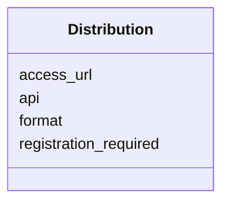

---
search:
  boost: 10.0
---

# Class: Distribution 


_One way of obtaining the data._


<div data-search-exclude markdown="1">


URI: [dcat:Distribution](http://www.w3.org/ns/dcat#Distribution)





<!-- no inheritance hierarchy -->

## Class Properties

| Property | Value |
| --- | --- |
| Class URI | [dcat:Distribution](http://www.w3.org/ns/dcat#Distribution) |


## Slots

| Name | Cardinality and Range | Description | Inheritance |
| ---  | --- | --- | --- |
| [format](format.md) | 0..1 <br/> [String](String.md) | File format or media type of a distribution (for example CSV, GeoParquet, Net... | direct |
| [access_url](access_url.md) | 0..1 <br/> [String](String.md) | URL from which a distribution can be accessed or downloaded | direct |
| [api](api.md) | 0..1 <br/> [Boolean](Boolean.md) | True if the distribution is a programmatic interface (API or web service) rat... | direct |
| [registration_required](registration_required.md) | 0..1 <br/> [Boolean](Boolean.md) | True if users must register or sign in before downloading | direct |


## Usages

| used by | used in | type | used |
| ---  | --- | --- | --- |
| [DatasetProfile](DatasetProfile.md) | [distributions](distributions.md) | range | [Distribution](Distribution.md) |


## Identifier and Mapping Information


### Schema Source


* from schema: https://w3id.org/ubem-link/schema


## Mappings

| Mapping Type | Mapped Value |
| ---  | ---  |
| self | dcat:Distribution |
| native | ubem_link:Distribution |


## LinkML Source

<!-- TODO: investigate https://stackoverflow.com/questions/37606292/how-to-create-tabbed-code-blocks-in-mkdocs-or-sphinx -->

### Direct

<details>
```yaml
name: Distribution
description: One way of obtaining the data.
from_schema: https://w3id.org/ubem-link/schema
slots:
- format
- access_url
- api
- registration_required
class_uri: dcat:Distribution

```
</details>

### Induced

<details>
```yaml
name: Distribution
description: One way of obtaining the data.
from_schema: https://w3id.org/ubem-link/schema
attributes:
  format:
    name: format
    description: File format or media type of a distribution (for example CSV, GeoParquet,
      NetCDF).
    from_schema: https://w3id.org/ubem-link/schema
    rank: 1000
    slot_uri: dct:format
    owner: Distribution
    domain_of:
    - Distribution
    range: string
  access_url:
    name: access_url
    description: URL from which a distribution can be accessed or downloaded.
    from_schema: https://w3id.org/ubem-link/schema
    rank: 1000
    slot_uri: dcat:accessURL
    owner: Distribution
    domain_of:
    - Distribution
    range: string
  api:
    name: api
    description: True if the distribution is a programmatic interface (API or web
      service) rather than a file.
    from_schema: https://w3id.org/ubem-link/schema
    rank: 1000
    owner: Distribution
    domain_of:
    - Distribution
    range: boolean
  registration_required:
    name: registration_required
    description: True if users must register or sign in before downloading.
    from_schema: https://w3id.org/ubem-link/schema
    rank: 1000
    owner: Distribution
    domain_of:
    - Distribution
    range: boolean
class_uri: dcat:Distribution

```
</details></div>