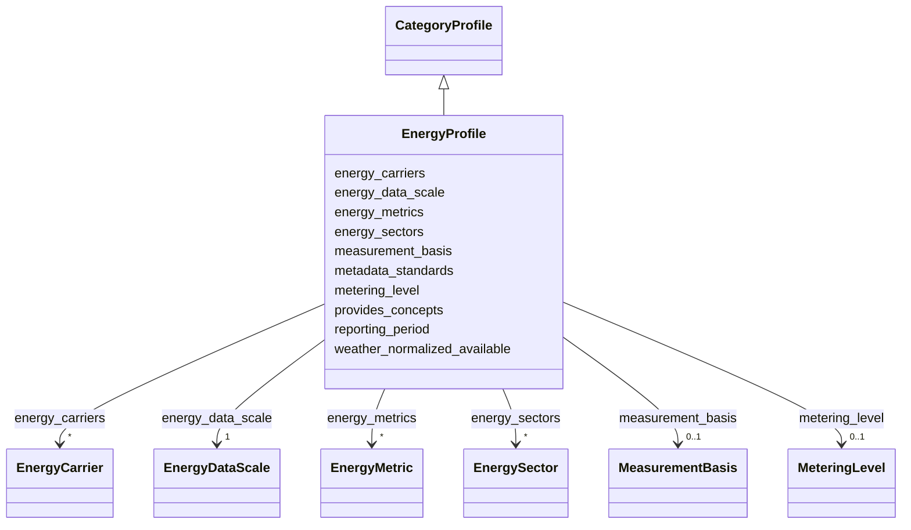

---
search:
  boost: 10.0
---

# Class: EnergyProfile 


_Measured or reported energy use for calibration and validation, from national balances (macroscopic) to buildings, meters and appliances (microscopic)._


<div data-search-exclude markdown="1">


URI: [ubem_link:EnergyProfile](https://w3id.org/ubem-link/EnergyProfile)





## Inheritance
* [CategoryProfile](CategoryProfile.md)
    * **EnergyProfile**


## Slots

| Name | Cardinality and Range | Description | Inheritance |
| ---  | --- | --- | --- |
| [energy_data_scale](energy_data_scale.md) | 1 <br/> [EnergyDataScale](EnergyDataScale.md) | Macroscopic (aggregates over many buildings) or microscopic (buildings, meter... | direct |
| [energy_sectors](energy_sectors.md) | * <br/> [EnergySector](EnergySector.md) | Energy-using sectors covered | direct |
| [energy_carriers](energy_carriers.md) | * <br/> [EnergyCarrier](EnergyCarrier.md) | Energy carriers reported | direct |
| [energy_metrics](energy_metrics.md) | * <br/> [EnergyMetric](EnergyMetric.md) | Kinds of energy quantity reported | direct |
| [metering_level](metering_level.md) | 0..1 <br/> [MeteringLevel](MeteringLevel.md) | Finest level at which energy is measured or reported | direct |
| [measurement_basis](measurement_basis.md) | 0..1 <br/> [MeasurementBasis](MeasurementBasis.md) | Whether values are metered, billed, self-reported or modeled | direct |
| [weather_normalized_available](weather_normalized_available.md) | 0..1 <br/> [Boolean](Boolean.md) | True if weather-normalized values are published alongside the actual ones | direct |
| [reporting_period](reporting_period.md) | 0..1 <br/> [String](String.md) | Period one value covers (for example calendar year, billing month) | direct |
| [provides_concepts](provides_concepts.md) | * <br/> [String](String.md) | Ids of the UBEM-Link concepts the dataset provides values for (its content at... | [CategoryProfile](CategoryProfile.md) |
| [metadata_standards](metadata_standards.md) | * <br/> [String](String.md) | Metadata standards or schemas the publisher already uses (for example Brick, ... | [CategoryProfile](CategoryProfile.md) |


## Usages

| used by | used in | type | used |
| ---  | --- | --- | --- |
| [DatasetProfile](DatasetProfile.md) | [energy_profile](energy_profile.md) | range | [EnergyProfile](EnergyProfile.md) |


## Identifier and Mapping Information


### Schema Source


* from schema: https://w3id.org/ubem-link/schema


## Mappings

| Mapping Type | Mapped Value |
| ---  | ---  |
| self | ubem_link:EnergyProfile |
| native | ubem_link:EnergyProfile |


## LinkML Source

<!-- TODO: investigate https://stackoverflow.com/questions/37606292/how-to-create-tabbed-code-blocks-in-mkdocs-or-sphinx -->

### Direct

<details>
```yaml
name: EnergyProfile
description: Measured or reported energy use for calibration and validation, from
  national balances (macroscopic) to buildings, meters and appliances (microscopic).
from_schema: https://w3id.org/ubem-link/schema
is_a: CategoryProfile
slots:
- energy_data_scale
- energy_sectors
- energy_carriers
- energy_metrics
- metering_level
- measurement_basis
- weather_normalized_available
- reporting_period
slot_usage:
  energy_data_scale:
    name: energy_data_scale
    required: true

```
</details>

### Induced

<details>
```yaml
name: EnergyProfile
description: Measured or reported energy use for calibration and validation, from
  national balances (macroscopic) to buildings, meters and appliances (microscopic).
from_schema: https://w3id.org/ubem-link/schema
is_a: CategoryProfile
slot_usage:
  energy_data_scale:
    name: energy_data_scale
    required: true
attributes:
  energy_data_scale:
    name: energy_data_scale
    description: Macroscopic (aggregates over many buildings) or microscopic (buildings,
      meters, circuits or appliances).
    from_schema: https://w3id.org/ubem-link/schema
    rank: 1000
    owner: EnergyProfile
    domain_of:
    - EnergyProfile
    range: EnergyDataScale
    required: true
  energy_sectors:
    name: energy_sectors
    description: Energy-using sectors covered.
    from_schema: https://w3id.org/ubem-link/schema
    rank: 1000
    owner: EnergyProfile
    domain_of:
    - EnergyProfile
    range: EnergySector
    multivalued: true
  energy_carriers:
    name: energy_carriers
    description: Energy carriers reported.
    from_schema: https://w3id.org/ubem-link/schema
    rank: 1000
    owner: EnergyProfile
    domain_of:
    - EnergyProfile
    range: EnergyCarrier
    multivalued: true
  energy_metrics:
    name: energy_metrics
    description: Kinds of energy quantity reported.
    from_schema: https://w3id.org/ubem-link/schema
    rank: 1000
    owner: EnergyProfile
    domain_of:
    - EnergyProfile
    range: EnergyMetric
    multivalued: true
  metering_level:
    name: metering_level
    description: Finest level at which energy is measured or reported.
    from_schema: https://w3id.org/ubem-link/schema
    rank: 1000
    owner: EnergyProfile
    domain_of:
    - EnergyProfile
    range: MeteringLevel
  measurement_basis:
    name: measurement_basis
    description: Whether values are metered, billed, self-reported or modeled.
    from_schema: https://w3id.org/ubem-link/schema
    rank: 1000
    owner: EnergyProfile
    domain_of:
    - EnergyProfile
    range: MeasurementBasis
  weather_normalized_available:
    name: weather_normalized_available
    description: True if weather-normalized values are published alongside the actual
      ones.
    from_schema: https://w3id.org/ubem-link/schema
    rank: 1000
    owner: EnergyProfile
    domain_of:
    - EnergyProfile
    range: boolean
  reporting_period:
    name: reporting_period
    description: Period one value covers (for example calendar year, billing month).
    from_schema: https://w3id.org/ubem-link/schema
    rank: 1000
    owner: EnergyProfile
    domain_of:
    - EnergyProfile
    range: string
  provides_concepts:
    name: provides_concepts
    description: Ids of the UBEM-Link concepts the dataset provides values for (its
      content at concept level).
    from_schema: https://w3id.org/ubem-link/schema
    rank: 1000
    owner: EnergyProfile
    domain_of:
    - CategoryProfile
    range: string
    multivalued: true
  metadata_standards:
    name: metadata_standards
    description: Metadata standards or schemas the publisher already uses (for example
      Brick, BuildingSync, DDI-Codebook, CityGML).
    from_schema: https://w3id.org/ubem-link/schema
    rank: 1000
    owner: EnergyProfile
    domain_of:
    - CategoryProfile
    range: string
    multivalued: true

```
</details></div>