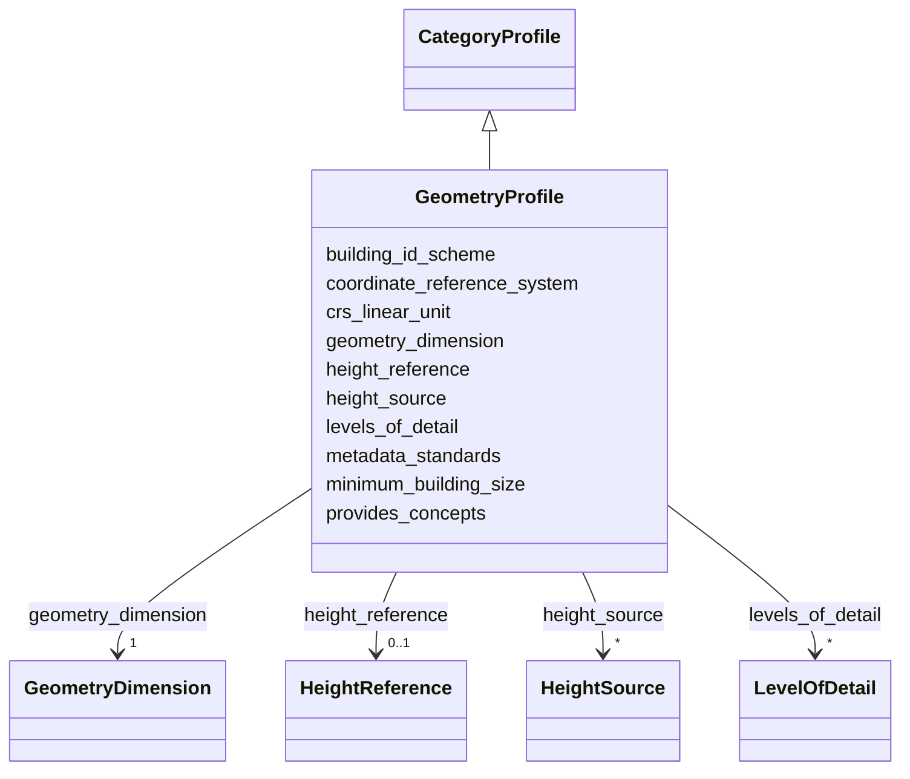

---
search:
  boost: 10.0
---

# Class: GeometryProfile 


_Building stock geometry and inventory: footprints, heights, 3D city models and parcels._


<div data-search-exclude markdown="1">


URI: [ubem_link:GeometryProfile](https://w3id.org/ubem-link/GeometryProfile)





## Inheritance
* [CategoryProfile](CategoryProfile.md)
    * **GeometryProfile**


## Slots

| Name | Cardinality and Range | Description | Inheritance |
| ---  | --- | --- | --- |
| [geometry_dimension](geometry_dimension.md) | 1 <br/> [GeometryDimension](GeometryDimension.md) | Geometric representation of buildings, from points and footprints to 3D solid... | direct |
| [levels_of_detail](levels_of_detail.md) | * <br/> [LevelOfDetail](LevelOfDetail.md) | CityGML levels of detail provided | direct |
| [height_source](height_source.md) | * <br/> [HeightSource](HeightSource.md) | How building heights were obtained | direct |
| [height_reference](height_reference.md) | 0..1 <br/> [HeightReference](HeightReference.md) | Reference points between which a building height is measured | direct |
| [coordinate_reference_system](coordinate_reference_system.md) | 0..1 <br/> [String](String.md) | Coordinate reference system of the published geometry, as an EPSG code (for e... | direct |
| [crs_linear_unit](crs_linear_unit.md) | 0..1 <br/> [String](String.md) | Linear unit of the coordinate reference system and of lengths and areas deriv... | direct |
| [building_id_scheme](building_id_scheme.md) | 0..1 <br/> [String](String.md) | Building identifier system used (for example BIN, UPRN, BAG, UBID); null if n... | direct |
| [minimum_building_size](minimum_building_size.md) | 0..1 <br/> [String](String.md) | Capture threshold for buildings, as stated by the publisher (for example 'lar... | direct |
| [provides_concepts](provides_concepts.md) | * <br/> [String](String.md) | Ids of the UBEM-Link concepts the dataset provides values for (its content at... | [CategoryProfile](CategoryProfile.md) |
| [metadata_standards](metadata_standards.md) | * <br/> [String](String.md) | Metadata standards or schemas the publisher already uses (for example Brick, ... | [CategoryProfile](CategoryProfile.md) |


## Usages

| used by | used in | type | used |
| ---  | --- | --- | --- |
| [DatasetProfile](DatasetProfile.md) | [geometry_profile](geometry_profile.md) | range | [GeometryProfile](GeometryProfile.md) |


## Identifier and Mapping Information


### Schema Source


* from schema: https://w3id.org/ubem-link/schema


## Mappings

| Mapping Type | Mapped Value |
| ---  | ---  |
| self | ubem_link:GeometryProfile |
| native | ubem_link:GeometryProfile |


## LinkML Source

<!-- TODO: investigate https://stackoverflow.com/questions/37606292/how-to-create-tabbed-code-blocks-in-mkdocs-or-sphinx -->

### Direct

<details>
```yaml
name: GeometryProfile
description: 'Building stock geometry and inventory: footprints, heights, 3D city
  models and parcels.'
from_schema: https://w3id.org/ubem-link/schema
is_a: CategoryProfile
slots:
- geometry_dimension
- levels_of_detail
- height_source
- height_reference
- coordinate_reference_system
- crs_linear_unit
- building_id_scheme
- minimum_building_size
slot_usage:
  geometry_dimension:
    name: geometry_dimension
    required: true

```
</details>

### Induced

<details>
```yaml
name: GeometryProfile
description: 'Building stock geometry and inventory: footprints, heights, 3D city
  models and parcels.'
from_schema: https://w3id.org/ubem-link/schema
is_a: CategoryProfile
slot_usage:
  geometry_dimension:
    name: geometry_dimension
    required: true
attributes:
  geometry_dimension:
    name: geometry_dimension
    description: Geometric representation of buildings, from points and footprints
      to 3D solids.
    from_schema: https://w3id.org/ubem-link/schema
    rank: 1000
    owner: GeometryProfile
    domain_of:
    - GeometryProfile
    range: GeometryDimension
    required: true
  levels_of_detail:
    name: levels_of_detail
    description: CityGML levels of detail provided.
    from_schema: https://w3id.org/ubem-link/schema
    rank: 1000
    owner: GeometryProfile
    domain_of:
    - GeometryProfile
    range: LevelOfDetail
    multivalued: true
  height_source:
    name: height_source
    description: How building heights were obtained.
    from_schema: https://w3id.org/ubem-link/schema
    rank: 1000
    owner: GeometryProfile
    domain_of:
    - GeometryProfile
    range: HeightSource
    multivalued: true
  height_reference:
    name: height_reference
    description: Reference points between which a building height is measured.
    from_schema: https://w3id.org/ubem-link/schema
    rank: 1000
    owner: GeometryProfile
    domain_of:
    - GeometryProfile
    range: HeightReference
  coordinate_reference_system:
    name: coordinate_reference_system
    description: Coordinate reference system of the published geometry, as an EPSG
      code (for example EPSG:4326).
    from_schema: https://w3id.org/ubem-link/schema
    rank: 1000
    owner: GeometryProfile
    domain_of:
    - GeometryProfile
    range: string
    pattern: ^EPSG:[0-9]+$
  crs_linear_unit:
    name: crs_linear_unit
    description: Linear unit of the coordinate reference system and of lengths and
      areas derived from it (QUDT CURIE, for example unit:FT_US or unit:M).
    from_schema: https://w3id.org/ubem-link/schema
    rank: 1000
    owner: GeometryProfile
    domain_of:
    - GeometryProfile
    range: string
  building_id_scheme:
    name: building_id_scheme
    description: Building identifier system used (for example BIN, UPRN, BAG, UBID);
      null if none.
    from_schema: https://w3id.org/ubem-link/schema
    rank: 1000
    owner: GeometryProfile
    domain_of:
    - GeometryProfile
    range: string
  minimum_building_size:
    name: minimum_building_size
    description: Capture threshold for buildings, as stated by the publisher (for
      example 'larger than 400 sq ft').
    from_schema: https://w3id.org/ubem-link/schema
    rank: 1000
    owner: GeometryProfile
    domain_of:
    - GeometryProfile
    range: string
  provides_concepts:
    name: provides_concepts
    description: Ids of the UBEM-Link concepts the dataset provides values for (its
      content at concept level).
    from_schema: https://w3id.org/ubem-link/schema
    rank: 1000
    owner: GeometryProfile
    domain_of:
    - CategoryProfile
    range: string
    multivalued: true
  metadata_standards:
    name: metadata_standards
    description: Metadata standards or schemas the publisher already uses (for example
      Brick, BuildingSync, DDI-Codebook, CityGML).
    from_schema: https://w3id.org/ubem-link/schema
    rank: 1000
    owner: GeometryProfile
    domain_of:
    - CategoryProfile
    range: string
    multivalued: true

```
</details></div>