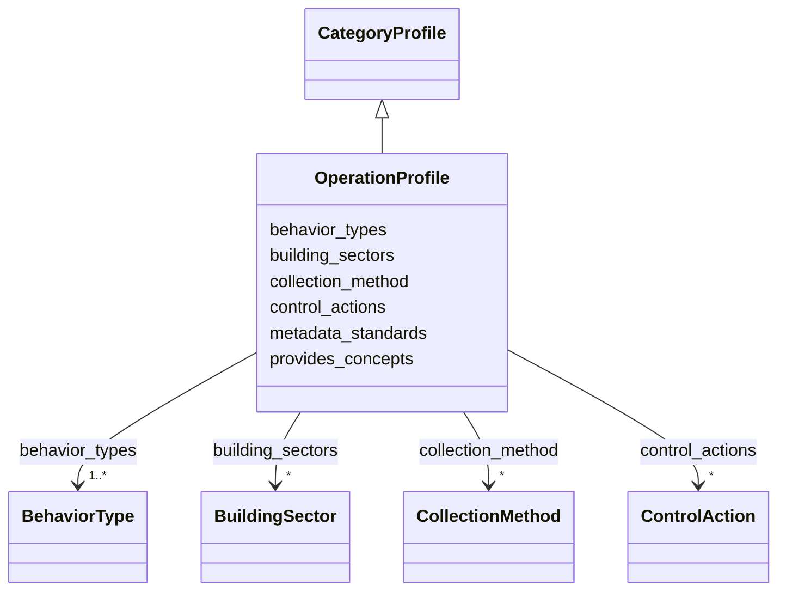

---
search:
  boost: 10.0
---

# Class: OperationProfile 


_Occupancy, occupant behavior, schedules, setpoints and time use._


<div data-search-exclude markdown="1">


URI: [ubem_link:OperationProfile](https://w3id.org/ubem-link/OperationProfile)





## Inheritance
* [CategoryProfile](CategoryProfile.md)
    * **OperationProfile**


## Slots

| Name | Cardinality and Range | Description | Inheritance |
| ---  | --- | --- | --- |
| [behavior_types](behavior_types.md) | 1..* <br/> [BehaviorType](BehaviorType.md) | Kinds of occupant behavior or building operation recorded | direct |
| [control_actions](control_actions.md) | * <br/> [ControlAction](ControlAction.md) | Occupant control actions recorded | direct |
| [collection_method](collection_method.md) | * <br/> [CollectionMethod](CollectionMethod.md) | How the behavior or operation data were collected | direct |
| [building_sectors](building_sectors.md) | * <br/> [BuildingSector](BuildingSector.md) | Building sectors covered | direct |
| [provides_concepts](provides_concepts.md) | * <br/> [String](String.md) | Ids of the UBEM-Link concepts the dataset provides values for (its content at... | [CategoryProfile](CategoryProfile.md) |
| [metadata_standards](metadata_standards.md) | * <br/> [String](String.md) | Metadata standards or schemas the publisher already uses (for example Brick, ... | [CategoryProfile](CategoryProfile.md) |


## Usages

| used by | used in | type | used |
| ---  | --- | --- | --- |
| [DatasetProfile](DatasetProfile.md) | [operation_profile](operation_profile.md) | range | [OperationProfile](OperationProfile.md) |


## Identifier and Mapping Information


### Schema Source


* from schema: https://w3id.org/ubem-link/schema


## Mappings

| Mapping Type | Mapped Value |
| ---  | ---  |
| self | ubem_link:OperationProfile |
| native | ubem_link:OperationProfile |


## LinkML Source

<!-- TODO: investigate https://stackoverflow.com/questions/37606292/how-to-create-tabbed-code-blocks-in-mkdocs-or-sphinx -->

### Direct

<details>
```yaml
name: OperationProfile
description: Occupancy, occupant behavior, schedules, setpoints and time use.
from_schema: https://w3id.org/ubem-link/schema
is_a: CategoryProfile
slots:
- behavior_types
- control_actions
- collection_method
- building_sectors
slot_usage:
  behavior_types:
    name: behavior_types
    required: true

```
</details>

### Induced

<details>
```yaml
name: OperationProfile
description: Occupancy, occupant behavior, schedules, setpoints and time use.
from_schema: https://w3id.org/ubem-link/schema
is_a: CategoryProfile
slot_usage:
  behavior_types:
    name: behavior_types
    required: true
attributes:
  behavior_types:
    name: behavior_types
    description: Kinds of occupant behavior or building operation recorded.
    from_schema: https://w3id.org/ubem-link/schema
    rank: 1000
    owner: OperationProfile
    domain_of:
    - OperationProfile
    range: BehaviorType
    required: true
    multivalued: true
  control_actions:
    name: control_actions
    description: Occupant control actions recorded.
    from_schema: https://w3id.org/ubem-link/schema
    rank: 1000
    owner: OperationProfile
    domain_of:
    - OperationProfile
    range: ControlAction
    multivalued: true
  collection_method:
    name: collection_method
    description: How the behavior or operation data were collected.
    from_schema: https://w3id.org/ubem-link/schema
    rank: 1000
    owner: OperationProfile
    domain_of:
    - OperationProfile
    range: CollectionMethod
    multivalued: true
  building_sectors:
    name: building_sectors
    description: Building sectors covered.
    from_schema: https://w3id.org/ubem-link/schema
    rank: 1000
    owner: OperationProfile
    domain_of:
    - OperationProfile
    - CharacteristicsProfile
    - SimulationProfile
    range: BuildingSector
    multivalued: true
  provides_concepts:
    name: provides_concepts
    description: Ids of the UBEM-Link concepts the dataset provides values for (its
      content at concept level).
    from_schema: https://w3id.org/ubem-link/schema
    rank: 1000
    owner: OperationProfile
    domain_of:
    - CategoryProfile
    range: string
    multivalued: true
  metadata_standards:
    name: metadata_standards
    description: Metadata standards or schemas the publisher already uses (for example
      Brick, BuildingSync, DDI-Codebook, CityGML).
    from_schema: https://w3id.org/ubem-link/schema
    rank: 1000
    owner: OperationProfile
    domain_of:
    - CategoryProfile
    range: string
    multivalued: true

```
</details></div>