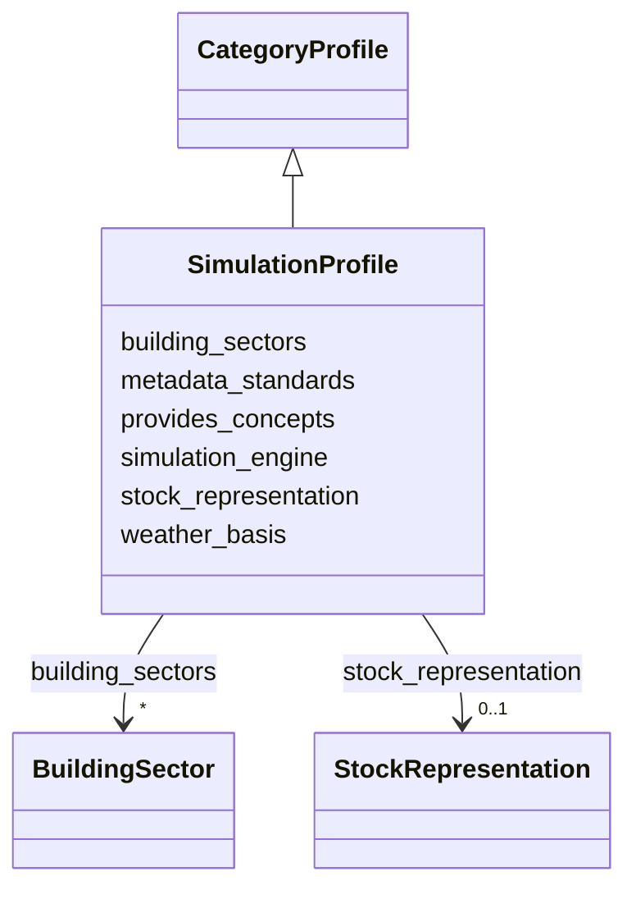

---
search:
  boost: 10.0
---

# Class: SimulationProfile 


_Reference simulations and model libraries: synthetic building-stock outputs and prototype models._


<div data-search-exclude markdown="1">


URI: [ubem_link:SimulationProfile](https://w3id.org/ubem-link/SimulationProfile)





## Inheritance
* [CategoryProfile](CategoryProfile.md)
    * **SimulationProfile**


## Slots

| Name | Cardinality and Range | Description | Inheritance |
| ---  | --- | --- | --- |
| [simulation_engine](simulation_engine.md) | 0..1 <br/> [String](String.md) | Simulation engine that produced the data (for example EnergyPlus) | direct |
| [stock_representation](stock_representation.md) | 0..1 <br/> [StockRepresentation](StockRepresentation.md) | How the simulated building stock is represented | direct |
| [weather_basis](weather_basis.md) | 0..1 <br/> [String](String.md) | Weather used for the simulations (for example AMY 2018, TMY3) | direct |
| [building_sectors](building_sectors.md) | * <br/> [BuildingSector](BuildingSector.md) | Building sectors covered | direct |
| [provides_concepts](provides_concepts.md) | * <br/> [String](String.md) | Ids of the UBEM-Link concepts the dataset provides values for (its content at... | [CategoryProfile](CategoryProfile.md) |
| [metadata_standards](metadata_standards.md) | * <br/> [String](String.md) | Metadata standards or schemas the publisher already uses (for example Brick, ... | [CategoryProfile](CategoryProfile.md) |


## Usages

| used by | used in | type | used |
| ---  | --- | --- | --- |
| [DatasetProfile](DatasetProfile.md) | [simulation_profile](simulation_profile.md) | range | [SimulationProfile](SimulationProfile.md) |


## Identifier and Mapping Information


### Schema Source


* from schema: https://w3id.org/ubem-link/schema


## Mappings

| Mapping Type | Mapped Value |
| ---  | ---  |
| self | ubem_link:SimulationProfile |
| native | ubem_link:SimulationProfile |


## LinkML Source

<!-- TODO: investigate https://stackoverflow.com/questions/37606292/how-to-create-tabbed-code-blocks-in-mkdocs-or-sphinx -->

### Direct

<details>
```yaml
name: SimulationProfile
description: 'Reference simulations and model libraries: synthetic building-stock
  outputs and prototype models.'
from_schema: https://w3id.org/ubem-link/schema
is_a: CategoryProfile
slots:
- simulation_engine
- stock_representation
- weather_basis
- building_sectors

```
</details>

### Induced

<details>
```yaml
name: SimulationProfile
description: 'Reference simulations and model libraries: synthetic building-stock
  outputs and prototype models.'
from_schema: https://w3id.org/ubem-link/schema
is_a: CategoryProfile
attributes:
  simulation_engine:
    name: simulation_engine
    description: Simulation engine that produced the data (for example EnergyPlus).
    from_schema: https://w3id.org/ubem-link/schema
    rank: 1000
    owner: SimulationProfile
    domain_of:
    - SimulationProfile
    range: string
  stock_representation:
    name: stock_representation
    description: How the simulated building stock is represented.
    from_schema: https://w3id.org/ubem-link/schema
    rank: 1000
    owner: SimulationProfile
    domain_of:
    - SimulationProfile
    range: StockRepresentation
  weather_basis:
    name: weather_basis
    description: Weather used for the simulations (for example AMY 2018, TMY3).
    from_schema: https://w3id.org/ubem-link/schema
    rank: 1000
    owner: SimulationProfile
    domain_of:
    - SimulationProfile
    range: string
  building_sectors:
    name: building_sectors
    description: Building sectors covered.
    from_schema: https://w3id.org/ubem-link/schema
    rank: 1000
    owner: SimulationProfile
    domain_of:
    - OperationProfile
    - CharacteristicsProfile
    - SimulationProfile
    range: BuildingSector
    multivalued: true
  provides_concepts:
    name: provides_concepts
    description: Ids of the UBEM-Link concepts the dataset provides values for (its
      content at concept level).
    from_schema: https://w3id.org/ubem-link/schema
    rank: 1000
    owner: SimulationProfile
    domain_of:
    - CategoryProfile
    range: string
    multivalued: true
  metadata_standards:
    name: metadata_standards
    description: Metadata standards or schemas the publisher already uses (for example
      Brick, BuildingSync, DDI-Codebook, CityGML).
    from_schema: https://w3id.org/ubem-link/schema
    rank: 1000
    owner: SimulationProfile
    domain_of:
    - CategoryProfile
    range: string
    multivalued: true

```
</details></div>