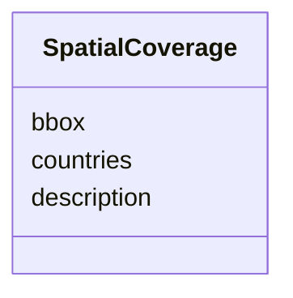

---
search:
  boost: 10.0
---

# Class: SpatialCoverage 


_Geographic area a dataset covers._


<div data-search-exclude markdown="1">


URI: [dct:Location](http://purl.org/dc/terms/Location)





<!-- no inheritance hierarchy -->

## Class Properties

| Property | Value |
| --- | --- |
| Class URI | [dct:Location](http://purl.org/dc/terms/Location) |


## Slots

| Name | Cardinality and Range | Description | Inheritance |
| ---  | --- | --- | --- |
| [countries](countries.md) | * <br/> [String](String.md) | ISO 3166-1 alpha-2 codes, or GLOBAL | direct |
| [description](description.md) | 0..1 <br/> [String](String.md) | Longer description of the variable, such as the question text | direct |
| [bbox](bbox.md) | 0..1 <br/> [String](String.md) | WGS84 bounding box "minLon,minLat,maxLon,maxLat" when meaningful | direct |


## Usages

| used by | used in | type | used |
| ---  | --- | --- | --- |
| [DatasetProfile](DatasetProfile.md) | [spatial_coverage](spatial_coverage.md) | range | [SpatialCoverage](SpatialCoverage.md) |


## Identifier and Mapping Information


### Schema Source


* from schema: https://w3id.org/ubem-link/schema


## Mappings

| Mapping Type | Mapped Value |
| ---  | ---  |
| self | dct:Location |
| native | ubem_link:SpatialCoverage |


## LinkML Source

<!-- TODO: investigate https://stackoverflow.com/questions/37606292/how-to-create-tabbed-code-blocks-in-mkdocs-or-sphinx -->

### Direct

<details>
```yaml
name: SpatialCoverage
description: Geographic area a dataset covers.
from_schema: https://w3id.org/ubem-link/schema
slots:
- countries
- description
- bbox
class_uri: dct:Location

```
</details>

### Induced

<details>
```yaml
name: SpatialCoverage
description: Geographic area a dataset covers.
from_schema: https://w3id.org/ubem-link/schema
attributes:
  countries:
    name: countries
    description: ISO 3166-1 alpha-2 codes, or GLOBAL.
    from_schema: https://w3id.org/ubem-link/schema
    rank: 1000
    owner: SpatialCoverage
    domain_of:
    - SpatialCoverage
    range: string
    multivalued: true
    pattern: ^([A-Z]{2}|GLOBAL|EU)$
  description:
    name: description
    description: Longer description of the variable, such as the question text.
    from_schema: https://w3id.org/ubem-link/schema
    rank: 1000
    slot_uri: dct:description
    owner: SpatialCoverage
    domain_of:
    - SpatialCoverage
    - VariableProfile
    range: string
  bbox:
    name: bbox
    description: WGS84 bounding box "minLon,minLat,maxLon,maxLat" when meaningful.
    from_schema: https://w3id.org/ubem-link/schema
    rank: 1000
    slot_uri: dcat:bbox
    owner: SpatialCoverage
    domain_of:
    - SpatialCoverage
    range: string
class_uri: dct:Location

```
</details></div>