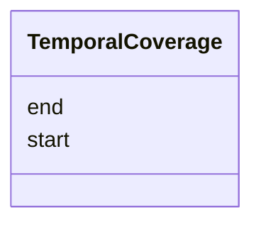

---
search:
  boost: 10.0
---

# Class: TemporalCoverage 


_Period of time a dataset covers._


<div data-search-exclude markdown="1">


URI: [dct:PeriodOfTime](http://purl.org/dc/terms/PeriodOfTime)





<!-- no inheritance hierarchy -->

## Class Properties

| Property | Value |
| --- | --- |
| Class URI | [dct:PeriodOfTime](http://purl.org/dc/terms/PeriodOfTime) |


## Slots

| Name | Cardinality and Range | Description | Inheritance |
| ---  | --- | --- | --- |
| [start](start.md) | 0..1 <br/> [String](String.md) | First period covered (ISO 8601 year, month or date) | direct |
| [end](end.md) | 0..1 <br/> [String](String.md) | Last period covered (ISO 8601), or 'present' for an ongoing series | direct |


## Usages

| used by | used in | type | used |
| ---  | --- | --- | --- |
| [DatasetProfile](DatasetProfile.md) | [temporal_coverage](temporal_coverage.md) | range | [TemporalCoverage](TemporalCoverage.md) |


## Identifier and Mapping Information


### Schema Source


* from schema: https://w3id.org/ubem-link/schema


## Mappings

| Mapping Type | Mapped Value |
| ---  | ---  |
| self | dct:PeriodOfTime |
| native | ubem_link:TemporalCoverage |


## LinkML Source

<!-- TODO: investigate https://stackoverflow.com/questions/37606292/how-to-create-tabbed-code-blocks-in-mkdocs-or-sphinx -->

### Direct

<details>
```yaml
name: TemporalCoverage
description: Period of time a dataset covers.
from_schema: https://w3id.org/ubem-link/schema
slots:
- start
- end
class_uri: dct:PeriodOfTime

```
</details>

### Induced

<details>
```yaml
name: TemporalCoverage
description: Period of time a dataset covers.
from_schema: https://w3id.org/ubem-link/schema
attributes:
  start:
    name: start
    description: First period covered (ISO 8601 year, month or date).
    from_schema: https://w3id.org/ubem-link/schema
    rank: 1000
    slot_uri: dcat:startDate
    owner: TemporalCoverage
    domain_of:
    - TemporalCoverage
    range: string
  end:
    name: end
    description: Last period covered (ISO 8601), or 'present' for an ongoing series.
    from_schema: https://w3id.org/ubem-link/schema
    rank: 1000
    slot_uri: dcat:endDate
    owner: TemporalCoverage
    domain_of:
    - TemporalCoverage
    range: string
class_uri: dct:PeriodOfTime

```
</details></div>