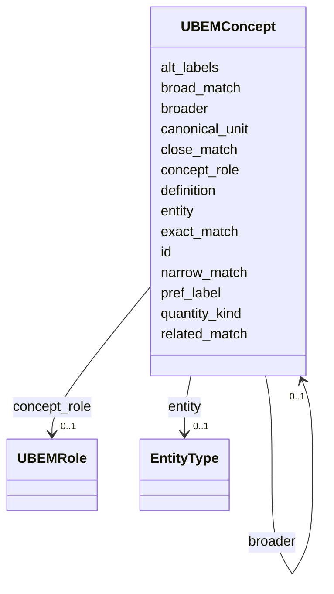

---
search:
  boost: 10.0
---

# Class: UBEMConcept 


_A concept in the UBEM-Link vocabulary: a quantity or attribute that a UBEM workflow consumes or produces (for example floor area, principal building activity, dry-bulb temperature, annual electricity use). Concepts form a hierarchy through `broader` and point to equivalent terms in other standards._


<div data-search-exclude markdown="1">


URI: [skos:Concept](http://www.w3.org/2004/02/skos/core#Concept)





<!-- no inheritance hierarchy -->

## Class Properties

| Property | Value |
| --- | --- |
| Class URI | [skos:Concept](http://www.w3.org/2004/02/skos/core#Concept) |


## Slots

| Name | Cardinality and Range | Description | Inheritance |
| ---  | --- | --- | --- |
| [id](id.md) | 1 <br/> [String](String.md) | Stable lowercase identifier of the record (letters, digits, '_', ' | direct |
| [pref_label](pref_label.md) | 1 <br/> [String](String.md) | Preferred human-readable label of the concept | direct |
| [definition](definition.md) | 1 <br/> [String](String.md) | What the concept means, written so that a person or an AI system can apply it... | direct |
| [alt_labels](alt_labels.md) | * <br/> [String](String.md) | Generic synonyms of the concept | direct |
| [broader](broader.md) | 0..1 <br/> [UBEMConcept](UBEMConcept.md) | The more general concept in the hierarchy (SKOS broader) | direct |
| [concept_role](concept_role.md) | 0..1 <br/> [UBEMRole](UBEMRole.md) | UBEM workflow role the concept belongs to | direct |
| [entity](entity.md) | 0..1 <br/> [EntityType](EntityType.md) | What the variable or concept describes (building, household, system, meter, r... | direct |
| [quantity_kind](quantity_kind.md) | 0..1 <br/> [String](String.md) | QUDT quantity kind CURIE, e | direct |
| [canonical_unit](canonical_unit.md) | 0..1 <br/> [String](String.md) | SI (or SI-accepted) unit in which normalized values are expressed | direct |
| [exact_match](exact_match.md) | * <br/> [String](String.md) | Term in another standard with the same meaning (SKOS exactMatch) | direct |
| [close_match](close_match.md) | * <br/> [String](String.md) | Term in another standard with nearly the same meaning (SKOS closeMatch) | direct |
| [broad_match](broad_match.md) | * <br/> [String](String.md) | Term in another standard that is more general (SKOS broadMatch) | direct |
| [narrow_match](narrow_match.md) | * <br/> [String](String.md) | Term in another standard that is more specific (SKOS narrowMatch) | direct |
| [related_match](related_match.md) | * <br/> [String](String.md) | Term in another standard that is associated but not equivalent (SKOS relatedM... | direct |


## Usages

| used by | used in | type | used |
| ---  | --- | --- | --- |
| [Catalog](Catalog.md) | [concepts](concepts.md) | range | [UBEMConcept](UBEMConcept.md) |
| [UBEMConcept](UBEMConcept.md) | [broader](broader.md) | range | [UBEMConcept](UBEMConcept.md) |


## Identifier and Mapping Information


### Schema Source


* from schema: https://w3id.org/ubem-link/schema


## Mappings

| Mapping Type | Mapped Value |
| ---  | ---  |
| self | skos:Concept |
| native | ubem_link:UBEMConcept |


## LinkML Source

<!-- TODO: investigate https://stackoverflow.com/questions/37606292/how-to-create-tabbed-code-blocks-in-mkdocs-or-sphinx -->

### Direct

<details>
```yaml
name: UBEMConcept
description: 'A concept in the UBEM-Link vocabulary: a quantity or attribute that
  a UBEM workflow consumes or produces (for example floor area, principal building
  activity, dry-bulb temperature, annual electricity use). Concepts form a hierarchy
  through `broader` and point to equivalent terms in other standards.'
from_schema: https://w3id.org/ubem-link/schema
slots:
- id
- pref_label
- definition
- alt_labels
- broader
- concept_role
- entity
- quantity_kind
- canonical_unit
- exact_match
- close_match
- broad_match
- narrow_match
- related_match
slot_usage:
  id:
    name: id
    required: true
  pref_label:
    name: pref_label
    required: true
  definition:
    name: definition
    required: true
class_uri: skos:Concept

```
</details>

### Induced

<details>
```yaml
name: UBEMConcept
description: 'A concept in the UBEM-Link vocabulary: a quantity or attribute that
  a UBEM workflow consumes or produces (for example floor area, principal building
  activity, dry-bulb temperature, annual electricity use). Concepts form a hierarchy
  through `broader` and point to equivalent terms in other standards.'
from_schema: https://w3id.org/ubem-link/schema
slot_usage:
  id:
    name: id
    required: true
  pref_label:
    name: pref_label
    required: true
  definition:
    name: definition
    required: true
attributes:
  id:
    name: id
    description: Stable lowercase identifier of the record (letters, digits, '_',
      '.', '-').
    from_schema: https://w3id.org/ubem-link/schema
    rank: 1000
    identifier: true
    owner: UBEMConcept
    domain_of:
    - DatasetProfile
    - UBEMConcept
    range: string
    required: true
    pattern: ^[a-z0-9][a-z0-9_.-]*$
  pref_label:
    name: pref_label
    description: Preferred human-readable label of the concept.
    from_schema: https://w3id.org/ubem-link/schema
    rank: 1000
    slot_uri: skos:prefLabel
    owner: UBEMConcept
    domain_of:
    - UBEMConcept
    range: string
    required: true
  definition:
    name: definition
    description: What the concept means, written so that a person or an AI system
      can apply it without other context.
    from_schema: https://w3id.org/ubem-link/schema
    rank: 1000
    slot_uri: skos:definition
    owner: UBEMConcept
    domain_of:
    - UBEMConcept
    range: string
    required: true
  alt_labels:
    name: alt_labels
    description: Generic synonyms of the concept.
    from_schema: https://w3id.org/ubem-link/schema
    rank: 1000
    slot_uri: skos:altLabel
    owner: UBEMConcept
    domain_of:
    - UBEMConcept
    range: string
    multivalued: true
  broader:
    name: broader
    description: The more general concept in the hierarchy (SKOS broader).
    from_schema: https://w3id.org/ubem-link/schema
    rank: 1000
    slot_uri: skos:broader
    owner: UBEMConcept
    domain_of:
    - UBEMConcept
    range: UBEMConcept
  concept_role:
    name: concept_role
    description: UBEM workflow role the concept belongs to.
    from_schema: https://w3id.org/ubem-link/schema
    rank: 1000
    owner: UBEMConcept
    domain_of:
    - UBEMConcept
    range: UBEMRole
  entity:
    name: entity
    description: What the variable or concept describes (building, household, system,
      meter, region, ...).
    from_schema: https://w3id.org/ubem-link/schema
    rank: 1000
    owner: UBEMConcept
    domain_of:
    - VariableProfile
    - UBEMConcept
    range: EntityType
  quantity_kind:
    name: quantity_kind
    description: QUDT quantity kind CURIE, e.g. quantitykind:Area.
    from_schema: https://w3id.org/ubem-link/schema
    rank: 1000
    slot_uri: qudt:hasQuantityKind
    owner: UBEMConcept
    domain_of:
    - UBEMConcept
    range: string
  canonical_unit:
    name: canonical_unit
    description: SI (or SI-accepted) unit in which normalized values are expressed.
    from_schema: https://w3id.org/ubem-link/schema
    rank: 1000
    owner: UBEMConcept
    domain_of:
    - UBEMConcept
    range: string
  exact_match:
    name: exact_match
    description: Term in another standard with the same meaning (SKOS exactMatch).
    from_schema: https://w3id.org/ubem-link/schema
    rank: 1000
    slot_uri: skos:exactMatch
    owner: UBEMConcept
    domain_of:
    - UBEMConcept
    range: string
    multivalued: true
  close_match:
    name: close_match
    description: Term in another standard with nearly the same meaning (SKOS closeMatch).
    from_schema: https://w3id.org/ubem-link/schema
    rank: 1000
    slot_uri: skos:closeMatch
    owner: UBEMConcept
    domain_of:
    - UBEMConcept
    range: string
    multivalued: true
  broad_match:
    name: broad_match
    description: Term in another standard that is more general (SKOS broadMatch).
    from_schema: https://w3id.org/ubem-link/schema
    rank: 1000
    slot_uri: skos:broadMatch
    owner: UBEMConcept
    domain_of:
    - UBEMConcept
    range: string
    multivalued: true
  narrow_match:
    name: narrow_match
    description: Term in another standard that is more specific (SKOS narrowMatch).
    from_schema: https://w3id.org/ubem-link/schema
    rank: 1000
    slot_uri: skos:narrowMatch
    owner: UBEMConcept
    domain_of:
    - UBEMConcept
    range: string
    multivalued: true
  related_match:
    name: related_match
    description: Term in another standard that is associated but not equivalent (SKOS
      relatedMatch).
    from_schema: https://w3id.org/ubem-link/schema
    rank: 1000
    slot_uri: skos:relatedMatch
    owner: UBEMConcept
    domain_of:
    - UBEMConcept
    range: string
    multivalued: true
class_uri: skos:Concept

```
</details></div>