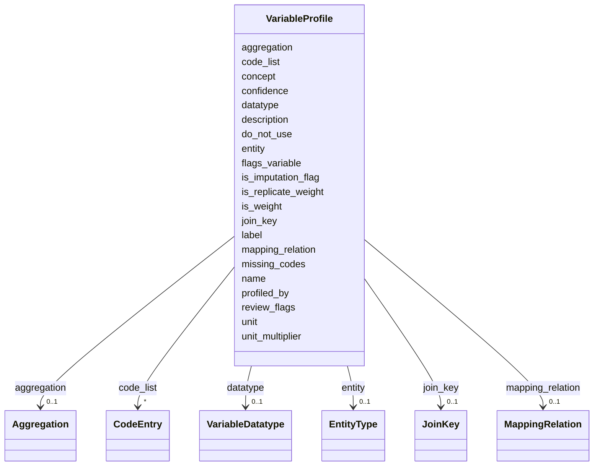

---
search:
  boost: 10.0
---

# Class: VariableProfile 


_Variable-level (column-level) semantics. One VariableProfile per column of a tabular dataset, or per variable of a gridded dataset._


<div data-search-exclude markdown="1">


URI: [csvw:Column](http://www.w3.org/ns/csvw#Column)





<!-- no inheritance hierarchy -->

## Class Properties

| Property | Value |
| --- | --- |
| Class URI | [csvw:Column](http://www.w3.org/ns/csvw#Column) |


## Slots

| Name | Cardinality and Range | Description | Inheritance |
| ---  | --- | --- | --- |
| [name](name.md) | 1 <br/> [String](String.md) | Variable name exactly as it appears in the data file | direct |
| [label](label.md) | 0..1 <br/> [String](String.md) | Short human-readable label of the variable as given in the codebook | direct |
| [description](description.md) | 0..1 <br/> [String](String.md) | Longer description of the variable, such as the question text | direct |
| [datatype](datatype.md) | 0..1 <br/> [VariableDatatype](VariableDatatype.md) | Data type of the variable's values | direct |
| [concept](concept.md) | 0..1 <br/> [String](String.md) | Id of the UBEMConcept this variable maps to, or "none" | direct |
| [mapping_relation](mapping_relation.md) | 0..1 <br/> [MappingRelation](MappingRelation.md) | SKOS relation between the variable and its concept (exact, close, broad, narr... | direct |
| [unit](unit.md) | 0..1 <br/> [String](String.md) | QUDT unit CURIE, e | direct |
| [unit_multiplier](unit_multiplier.md) | 0..1 <br/> [Float](Float.md) | Factor applied to raw values before the unit applies (e | direct |
| [aggregation](aggregation.md) | 0..1 <br/> [Aggregation](Aggregation.md) | How each value relates to time: static, instantaneous, total or average over ... | direct |
| [entity](entity.md) | 0..1 <br/> [EntityType](EntityType.md) | What the variable or concept describes (building, household, system, meter, r... | direct |
| [code_list](code_list.md) | * <br/> [CodeEntry](CodeEntry.md) | Codes of a categorical variable with their meanings | direct |
| [missing_codes](missing_codes.md) | * <br/> [String](String.md) | Raw values that mean missing, not applicable, or suppressed | direct |
| [is_weight](is_weight.md) | 0..1 <br/> [Boolean](Boolean.md) | True if the variable is a sampling or analysis weight; such variables are not... | direct |
| [is_replicate_weight](is_replicate_weight.md) | 0..1 <br/> [Boolean](Boolean.md) | True if the variable is a replicate weight used to estimate sampling variance | direct |
| [is_imputation_flag](is_imputation_flag.md) | 0..1 <br/> [Boolean](Boolean.md) | True if the variable records whether another variable was imputed | direct |
| [flags_variable](flags_variable.md) | 0..1 <br/> [String](String.md) | For an imputation or quality flag, the variable it refers to | direct |
| [join_key](join_key.md) | 0..1 <br/> [JoinKey](JoinKey.md) | Key type the variable holds, if it can link records to other datasets (for ex... | direct |
| [do_not_use](do_not_use.md) | 0..1 <br/> [Boolean](Boolean.md) | True if the publisher says the variable must not be used (the reason is in a ... | direct |
| [profiled_by](profiled_by.md) | 0..1 <br/> [String](String.md) | Who or what produced this variable profile (a person, or a model id such as o... | direct |
| [confidence](confidence.md) | 0..1 <br/> [Float](Float.md) | Confidence of an automatically produced mapping, between 0 and 1 | direct |
| [review_flags](review_flags.md) | * <br/> [String](String.md) | Reasons this profile should be reviewed by a person (failed checks, low confi... | direct |


## Usages

| used by | used in | type | used |
| ---  | --- | --- | --- |
| [DatasetProfile](DatasetProfile.md) | [variables](variables.md) | range | [VariableProfile](VariableProfile.md) |


## Identifier and Mapping Information


### Schema Source


* from schema: https://w3id.org/ubem-link/schema


## Mappings

| Mapping Type | Mapped Value |
| ---  | ---  |
| self | csvw:Column |
| native | ubem_link:VariableProfile |


## LinkML Source

<!-- TODO: investigate https://stackoverflow.com/questions/37606292/how-to-create-tabbed-code-blocks-in-mkdocs-or-sphinx -->

### Direct

<details>
```yaml
name: VariableProfile
description: Variable-level (column-level) semantics. One VariableProfile per column
  of a tabular dataset, or per variable of a gridded dataset.
from_schema: https://w3id.org/ubem-link/schema
slots:
- name
- label
- description
- datatype
- concept
- mapping_relation
- unit
- unit_multiplier
- aggregation
- entity
- code_list
- missing_codes
- is_weight
- is_replicate_weight
- is_imputation_flag
- flags_variable
- join_key
- do_not_use
- profiled_by
- confidence
- review_flags
slot_usage:
  name:
    name: name
    required: true
class_uri: csvw:Column

```
</details>

### Induced

<details>
```yaml
name: VariableProfile
description: Variable-level (column-level) semantics. One VariableProfile per column
  of a tabular dataset, or per variable of a gridded dataset.
from_schema: https://w3id.org/ubem-link/schema
slot_usage:
  name:
    name: name
    required: true
attributes:
  name:
    name: name
    description: Variable name exactly as it appears in the data file.
    from_schema: https://w3id.org/ubem-link/schema
    rank: 1000
    slot_uri: csvw:name
    owner: VariableProfile
    domain_of:
    - VariableProfile
    range: string
    required: true
  label:
    name: label
    description: Short human-readable label of the variable as given in the codebook.
    from_schema: https://w3id.org/ubem-link/schema
    rank: 1000
    slot_uri: skos:prefLabel
    owner: VariableProfile
    domain_of:
    - VariableProfile
    - CodeEntry
    range: string
  description:
    name: description
    description: Longer description of the variable, such as the question text.
    from_schema: https://w3id.org/ubem-link/schema
    rank: 1000
    slot_uri: dct:description
    owner: VariableProfile
    domain_of:
    - SpatialCoverage
    - VariableProfile
    range: string
  datatype:
    name: datatype
    description: Data type of the variable's values.
    from_schema: https://w3id.org/ubem-link/schema
    rank: 1000
    owner: VariableProfile
    domain_of:
    - VariableProfile
    range: VariableDatatype
  concept:
    name: concept
    description: Id of the UBEMConcept this variable maps to, or "none".
    from_schema: https://w3id.org/ubem-link/schema
    rank: 1000
    slot_uri: skos:related
    owner: VariableProfile
    domain_of:
    - VariableProfile
    range: string
  mapping_relation:
    name: mapping_relation
    description: SKOS relation between the variable and its concept (exact, close,
      broad, narrow, related).
    from_schema: https://w3id.org/ubem-link/schema
    rank: 1000
    owner: VariableProfile
    domain_of:
    - VariableProfile
    range: MappingRelation
  unit:
    name: unit
    description: QUDT unit CURIE, e.g. unit:FT2, unit:KiloBTU_IT, unit:KiloW-HR, unit:DEG_C.
    from_schema: https://w3id.org/ubem-link/schema
    rank: 1000
    slot_uri: qudt:unit
    owner: VariableProfile
    domain_of:
    - Convention
    - VariableProfile
    range: string
  unit_multiplier:
    name: unit_multiplier
    description: Factor applied to raw values before the unit applies (e.g., 1000
      for "thousand Btu").
    from_schema: https://w3id.org/ubem-link/schema
    rank: 1000
    owner: VariableProfile
    domain_of:
    - Convention
    - VariableProfile
    range: float
  aggregation:
    name: aggregation
    description: 'How each value relates to time: static, instantaneous, total or
      average over a period, count or share.'
    from_schema: https://w3id.org/ubem-link/schema
    rank: 1000
    owner: VariableProfile
    domain_of:
    - VariableProfile
    range: Aggregation
  entity:
    name: entity
    description: What the variable or concept describes (building, household, system,
      meter, region, ...).
    from_schema: https://w3id.org/ubem-link/schema
    rank: 1000
    owner: VariableProfile
    domain_of:
    - VariableProfile
    - UBEMConcept
    range: EntityType
  code_list:
    name: code_list
    description: Codes of a categorical variable with their meanings.
    from_schema: https://w3id.org/ubem-link/schema
    rank: 1000
    owner: VariableProfile
    domain_of:
    - VariableProfile
    range: CodeEntry
    multivalued: true
    inlined: true
    inlined_as_list: true
  missing_codes:
    name: missing_codes
    description: Raw values that mean missing, not applicable, or suppressed.
    from_schema: https://w3id.org/ubem-link/schema
    rank: 1000
    owner: VariableProfile
    domain_of:
    - Convention
    - VariableProfile
    range: string
    multivalued: true
  is_weight:
    name: is_weight
    description: True if the variable is a sampling or analysis weight; such variables
      are not observations.
    from_schema: https://w3id.org/ubem-link/schema
    rank: 1000
    owner: VariableProfile
    domain_of:
    - VariableProfile
    range: boolean
  is_replicate_weight:
    name: is_replicate_weight
    description: True if the variable is a replicate weight used to estimate sampling
      variance.
    from_schema: https://w3id.org/ubem-link/schema
    rank: 1000
    owner: VariableProfile
    domain_of:
    - VariableProfile
    range: boolean
  is_imputation_flag:
    name: is_imputation_flag
    description: True if the variable records whether another variable was imputed.
    from_schema: https://w3id.org/ubem-link/schema
    rank: 1000
    owner: VariableProfile
    domain_of:
    - VariableProfile
    range: boolean
  flags_variable:
    name: flags_variable
    description: For an imputation or quality flag, the variable it refers to.
    from_schema: https://w3id.org/ubem-link/schema
    rank: 1000
    owner: VariableProfile
    domain_of:
    - VariableProfile
    range: string
  join_key:
    name: join_key
    description: Key type the variable holds, if it can link records to other datasets
      (for example parcel_id for a tax-lot number).
    from_schema: https://w3id.org/ubem-link/schema
    rank: 1000
    owner: VariableProfile
    domain_of:
    - VariableProfile
    range: JoinKey
  do_not_use:
    name: do_not_use
    description: True if the publisher says the variable must not be used (the reason
      is in a convention).
    from_schema: https://w3id.org/ubem-link/schema
    rank: 1000
    owner: VariableProfile
    domain_of:
    - VariableProfile
    range: boolean
  profiled_by:
    name: profiled_by
    description: Who or what produced this variable profile (a person, or a model
      id such as ollama:qwen3:8b), and whether it was reviewed.
    from_schema: https://w3id.org/ubem-link/schema
    rank: 1000
    owner: VariableProfile
    domain_of:
    - VariableProfile
    range: string
  confidence:
    name: confidence
    description: Confidence of an automatically produced mapping, between 0 and 1.
    from_schema: https://w3id.org/ubem-link/schema
    rank: 1000
    owner: VariableProfile
    domain_of:
    - VariableProfile
    range: float
  review_flags:
    name: review_flags
    description: Reasons this profile should be reviewed by a person (failed checks,
      low confidence, disagreement).
    from_schema: https://w3id.org/ubem-link/schema
    rank: 1000
    owner: VariableProfile
    domain_of:
    - VariableProfile
    range: string
    multivalued: true
class_uri: csvw:Column

```
</details></div>