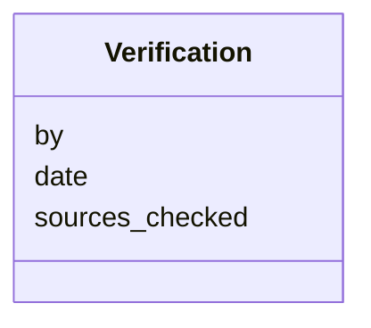

---
search:
  boost: 10.0
---

# Class: Verification 


_Provenance of the profile itself (who checked it, when, against which sources)._


<div data-search-exclude markdown="1">


URI: [prov:Activity](http://www.w3.org/ns/prov#Activity)





<!-- no inheritance hierarchy -->

## Class Properties

| Property | Value |
| --- | --- |
| Class URI | [prov:Activity](http://www.w3.org/ns/prov#Activity) |


## Slots

| Name | Cardinality and Range | Description | Inheritance |
| ---  | --- | --- | --- |
| [date](date.md) | 0..1 <br/> [String](String.md) | Date of the verification (ISO 8601) | direct |
| [by](by.md) | 0..1 <br/> [String](String.md) | Person or agent who carried out the verification | direct |
| [sources_checked](sources_checked.md) | * <br/> [Uri](Uri.md) | Pages and documents consulted during verification | direct |


## Usages

| used by | used in | type | used |
| ---  | --- | --- | --- |
| [DatasetProfile](DatasetProfile.md) | [verified](verified.md) | range | [Verification](Verification.md) |


## Identifier and Mapping Information


### Schema Source


* from schema: https://w3id.org/ubem-link/schema


## Mappings

| Mapping Type | Mapped Value |
| ---  | ---  |
| self | prov:Activity |
| native | ubem_link:Verification |


## LinkML Source

<!-- TODO: investigate https://stackoverflow.com/questions/37606292/how-to-create-tabbed-code-blocks-in-mkdocs-or-sphinx -->

### Direct

<details>
```yaml
name: Verification
description: Provenance of the profile itself (who checked it, when, against which
  sources).
from_schema: https://w3id.org/ubem-link/schema
slots:
- date
- by
- sources_checked
class_uri: prov:Activity

```
</details>

### Induced

<details>
```yaml
name: Verification
description: Provenance of the profile itself (who checked it, when, against which
  sources).
from_schema: https://w3id.org/ubem-link/schema
attributes:
  date:
    name: date
    description: Date of the verification (ISO 8601).
    from_schema: https://w3id.org/ubem-link/schema
    rank: 1000
    owner: Verification
    domain_of:
    - Verification
    range: string
  by:
    name: by
    description: Person or agent who carried out the verification.
    from_schema: https://w3id.org/ubem-link/schema
    rank: 1000
    owner: Verification
    domain_of:
    - Verification
    range: string
  sources_checked:
    name: sources_checked
    description: Pages and documents consulted during verification.
    from_schema: https://w3id.org/ubem-link/schema
    rank: 1000
    owner: Verification
    domain_of:
    - Verification
    range: uri
    multivalued: true
class_uri: prov:Activity

```
</details></div>