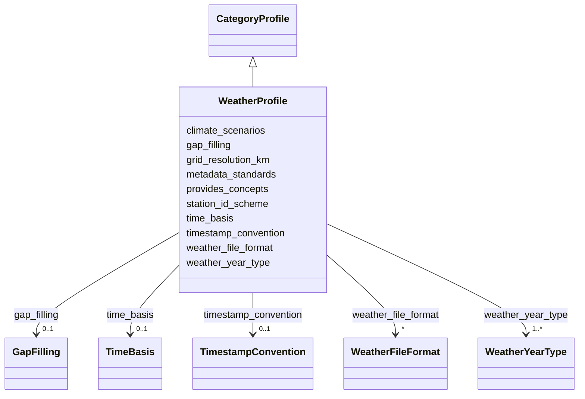

---
search:
  boost: 10.0
---

# Class: WeatherProfile 


_Weather and climate data used as boundary conditions: observed station records, reanalyses, typical and actual meteorological years, and climate projections._


<div data-search-exclude markdown="1">


URI: [ubem_link:WeatherProfile](https://w3id.org/ubem-link/WeatherProfile)





## Inheritance
* [CategoryProfile](CategoryProfile.md)
    * **WeatherProfile**


## Slots

| Name | Cardinality and Range | Description | Inheritance |
| ---  | --- | --- | --- |
| [weather_year_type](weather_year_type.md) | 1..* <br/> [WeatherYearType](WeatherYearType.md) | Kind of weather year or series: actual series, actual or typical meteorologic... | direct |
| [weather_file_format](weather_file_format.md) | * <br/> [WeatherFileFormat](WeatherFileFormat.md) | Formats in which weather is released, which decide whether a simulation engin... | direct |
| [timestamp_convention](timestamp_convention.md) | 0..1 <br/> [TimestampConvention](TimestampConvention.md) | Whether a timestamp marks the end, the start or the instant of the interval i... | direct |
| [time_basis](time_basis.md) | 0..1 <br/> [TimeBasis](TimeBasis.md) | Clock to which timestamps refer (UTC, local standard time, or local time with... | direct |
| [gap_filling](gap_filling.md) | 0..1 <br/> [GapFilling](GapFilling.md) | How missing or sub-interval values were filled by the publisher | direct |
| [grid_resolution_km](grid_resolution_km.md) | 0..1 <br/> [Float](Float.md) | Horizontal resolution of a gridded product in kilometres | direct |
| [station_id_scheme](station_id_scheme.md) | 0..1 <br/> [String](String.md) | Identifier system of the stations (for example WMO, USAF-WBAN, GHCN) | direct |
| [climate_scenarios](climate_scenarios.md) | * <br/> [String](String.md) | Emission or socio-economic scenarios of a projection (for example SSP2-4 | direct |
| [provides_concepts](provides_concepts.md) | * <br/> [String](String.md) | Ids of the UBEM-Link concepts the dataset provides values for (its content at... | [CategoryProfile](CategoryProfile.md) |
| [metadata_standards](metadata_standards.md) | * <br/> [String](String.md) | Metadata standards or schemas the publisher already uses (for example Brick, ... | [CategoryProfile](CategoryProfile.md) |


## Usages

| used by | used in | type | used |
| ---  | --- | --- | --- |
| [DatasetProfile](DatasetProfile.md) | [weather_profile](weather_profile.md) | range | [WeatherProfile](WeatherProfile.md) |


## Identifier and Mapping Information


### Schema Source


* from schema: https://w3id.org/ubem-link/schema


## Mappings

| Mapping Type | Mapped Value |
| ---  | ---  |
| self | ubem_link:WeatherProfile |
| native | ubem_link:WeatherProfile |


## LinkML Source

<!-- TODO: investigate https://stackoverflow.com/questions/37606292/how-to-create-tabbed-code-blocks-in-mkdocs-or-sphinx -->

### Direct

<details>
```yaml
name: WeatherProfile
description: 'Weather and climate data used as boundary conditions: observed station
  records, reanalyses, typical and actual meteorological years, and climate projections.'
from_schema: https://w3id.org/ubem-link/schema
is_a: CategoryProfile
slots:
- weather_year_type
- weather_file_format
- timestamp_convention
- time_basis
- gap_filling
- grid_resolution_km
- station_id_scheme
- climate_scenarios
slot_usage:
  weather_year_type:
    name: weather_year_type
    required: true

```
</details>

### Induced

<details>
```yaml
name: WeatherProfile
description: 'Weather and climate data used as boundary conditions: observed station
  records, reanalyses, typical and actual meteorological years, and climate projections.'
from_schema: https://w3id.org/ubem-link/schema
is_a: CategoryProfile
slot_usage:
  weather_year_type:
    name: weather_year_type
    required: true
attributes:
  weather_year_type:
    name: weather_year_type
    description: 'Kind of weather year or series: actual series, actual or typical
      meteorological year, normals, or projection.'
    from_schema: https://w3id.org/ubem-link/schema
    rank: 1000
    owner: WeatherProfile
    domain_of:
    - WeatherProfile
    range: WeatherYearType
    required: true
    multivalued: true
  weather_file_format:
    name: weather_file_format
    description: Formats in which weather is released, which decide whether a simulation
      engine can read it directly.
    from_schema: https://w3id.org/ubem-link/schema
    rank: 1000
    owner: WeatherProfile
    domain_of:
    - WeatherProfile
    range: WeatherFileFormat
    multivalued: true
  timestamp_convention:
    name: timestamp_convention
    description: Whether a timestamp marks the end, the start or the instant of the
      interval it describes.
    from_schema: https://w3id.org/ubem-link/schema
    rank: 1000
    owner: WeatherProfile
    domain_of:
    - WeatherProfile
    range: TimestampConvention
  time_basis:
    name: time_basis
    description: Clock to which timestamps refer (UTC, local standard time, or local
      time with daylight saving).
    from_schema: https://w3id.org/ubem-link/schema
    rank: 1000
    owner: WeatherProfile
    domain_of:
    - WeatherProfile
    range: TimeBasis
  gap_filling:
    name: gap_filling
    description: How missing or sub-interval values were filled by the publisher.
    from_schema: https://w3id.org/ubem-link/schema
    rank: 1000
    owner: WeatherProfile
    domain_of:
    - WeatherProfile
    range: GapFilling
  grid_resolution_km:
    name: grid_resolution_km
    description: Horizontal resolution of a gridded product in kilometres.
    from_schema: https://w3id.org/ubem-link/schema
    rank: 1000
    owner: WeatherProfile
    domain_of:
    - WeatherProfile
    range: float
  station_id_scheme:
    name: station_id_scheme
    description: Identifier system of the stations (for example WMO, USAF-WBAN, GHCN).
    from_schema: https://w3id.org/ubem-link/schema
    rank: 1000
    owner: WeatherProfile
    domain_of:
    - WeatherProfile
    range: string
  climate_scenarios:
    name: climate_scenarios
    description: Emission or socio-economic scenarios of a projection (for example
      SSP2-4.5, RCP8.5).
    from_schema: https://w3id.org/ubem-link/schema
    rank: 1000
    owner: WeatherProfile
    domain_of:
    - WeatherProfile
    range: string
    multivalued: true
  provides_concepts:
    name: provides_concepts
    description: Ids of the UBEM-Link concepts the dataset provides values for (its
      content at concept level).
    from_schema: https://w3id.org/ubem-link/schema
    rank: 1000
    owner: WeatherProfile
    domain_of:
    - CategoryProfile
    range: string
    multivalued: true
  metadata_standards:
    name: metadata_standards
    description: Metadata standards or schemas the publisher already uses (for example
      Brick, BuildingSync, DDI-Codebook, CityGML).
    from_schema: https://w3id.org/ubem-link/schema
    rank: 1000
    owner: WeatherProfile
    domain_of:
    - CategoryProfile
    range: string
    multivalued: true

```
</details></div>